# Guida Pratica a DRIFT

[English](GUIDE.md) · **Italiano**

<p align="center">
  
</p>

DRIFT mantiene un contratto di comportamento per ogni slice in
`.drift/contracts/<id>.toml`. L'owner umano approva una versione specifica del
contratto con sigilli separati per comportamento e assurance (`dr2b:` / `dr2a:`), e il gate di rilascio è **verde** (`green`) solo
quando i test eseguiti esattamente contro quella versione passano. Qualsiasi
modifica alle regole o agli esiti attesi del contratto rende l'approvazione
obsoleta (`stale`; spostare i percorsi `bind.code` non invalida il
digest comportamentale durante i refactoring interni, pertanto proteggi
`.drift/**` con `CODEOWNERS` e commit firmati su GitHub così ogni modifica a
`[approval]` o `[bind]` richiede revisione autenticata in PR), e
un'esecuzione di test precedente non può mai dimostrare un contratto più
recente.

Prima di iniziare, installa DRIFT seguendo **[INSTALL.it.md](INSTALL.it.md)** ([English](INSTALL.md)).

Tutti i contratti, i profili e le configurazioni dichiarano lo schema **`0.3`** (`drift = "0.3"`), che identifica la versione dello schema e non il numero di release della CLI.

---

## Concetti Chiave in 2 Minuti

| Concetto | File / Artefatto | Ruolo |
|---|---|---|
| **Area** | `.drift/config.toml` | Configurazione radice dell'area: nome, policy opzionale ed elenco degli approvatori autorizzati. |
| **Profilo** | `.drift/profiles/<name>@<ver>.toml` | Dichiara input/precondizioni tipizzati (`[schema.when]`) ed esiti (`[schema.then]`). |
| **Contratto** | `.drift/contracts/<slice>.toml` | Descrive il comportamento atteso di una slice: `[scope]`, `[cases.<id>]` e `[decisions.<id>]`. |
| **Approvazione** | `[approval]` (`behavior_ref = "dr2b:..."`, `assurance_ref = "dr2a:..."`) | Sigilli separati dell'owner; una modifica rende `stale` la relativa approvazione (`DR-E601`). |
| **Vista Risolta** | `<slice>.json` | JSON canonico esportato da `drift show --as json` e letto a runtime dai bridge di test. |
| **Evento di Prova** | `events.jsonl` + `.meta.json` | Emesso dai test runner (JUnit / Scala MUnit, Node.js, Python, Rust o V) quando i test vincolati vengono eseguiti. |
| **Gate** | `drift gate` | Verifica che configurazione e contratti siano approvati e che ogni caso, budget, ricevuta di sicurezza e prova formale abbia una prova valida e corrente. |

---

## Adottare DRIFT per Livelli Progressivi

Ogni livello porta valore immediato da solo: puoi fermarti al livello adatto al
tuo progetto o arrivare fino alla mutation analysis e alle attestazioni di
rilascio.

| Livello | Cosa aggiungi | Cosa ottieni | Edizione |
|---|---|---|---|
| **Livello 0** | `.drift/config.toml` + profili + contratti | Contratti per slice approvati dall'owner (inclusi vincoli relazionali `then`, `[invariants]`, frame `writes`, budget, guardie e obblighi formali in `[assurance]`) che diventano `stale` ad ogni modifica non approvata | **Free** |
| **Livello 1** | Test vincolati (`@DriftCase` / `Drift.expect`, `runDriftCase`, `run_drift_case`) | Un gate **verde** solo quando test reali (Java, Scala, JS/TS, Python, Rust o V) passano contro la versione approvata | **Free** |
| **Livello 2** | Selezione incrementale (`drift select`), `@recall`, scaffolding OpenAPI/AsyncAPI e da tracce | Esecuzione dei soli test e budget impattati, riuso sicuro delle prove tramite snapshot e generazione di contratti da specifiche o tracce runtime | **Pro** |
| **Livello 3** | `[policy]` (`core@1`) + `drift mutants` + `sweep --flow` + `gate --attest` (`--ssh-sign`) | Approvatori certificati, soglia minima `verified` o `killed`, audit architetturali FSM/Saga/sicurezza e bundle di attestazione CI firmati OpenSSH | **Enterprise** |

---

## Livello 0: Contratti, Decision Card e Approvazione dell'Owner

### 1. Inizializza un'Area

Crea una nuova area `.drift` nella radice del progetto:

```bash
drift init alice .
drift approve .drift/config.toml --by alice
```

### 2. Crea lo Scaffold di una Slice

`init` crea solo la configurazione. Crea `.drift/profiles/` e salva questo profilo compatibile in `.drift/profiles/http-json@1.toml` prima dello scaffold:

```toml
drift = "0.3"
profile = "http-json@1"

[schema.when]
request = { type = "string" }

[schema.then]
status = { type = "int" }
name = { type = "string" }
error = { type = "string" }
```

Poi genera il contratto (eredita la versione dello schema dal profilo):

```bash
drift new .drift/contracts/item-get.toml --profile http-json@1 --intent "Restituisce un articolo per id."
```

Per costruzione, uno scaffold appena generato **non può essere approvato subito**:
`indirect = "unknown"`, i valori `todo` e le domande aperte `[open.<id>]`
bloccano l'approvazione (`DR-E602`) finché non vengono risolti.

### 3. Compila Scope, Casi e Decision Card

Sostituisci i segnaposto con il comportamento reale della slice:

```toml
drift = "0.3"
id = "item-get"
intent = "Restituisce un articolo per id."

[use]
profile = "http-json@1"

[scope]
surface = "GET /items/{id}"
writes = []
reads = ["items"]
indirect = "none"

[bind]
code = ["src/main/java/example/items/**"]

[cases.found]
at = ["http"]
when.request = "GET /items/1"
then.status = 200
then.name = "lamp"

[cases.missing]
at = ["http"]
when.request = "GET /items/99"
then.status = 404
then.error = "not_found"

[decisions.cache-lookup]
kind = "choice"
ask = "Leggere direttamente dallo store primario o introdurre una cache in memoria?"
pick = "primary-store"
cases = ["found", "missing"]
note = "La latenza su nodo singolo è <2ms; una cache aggiunge complessità di invalidazione."
evidence = "observed"
why = "La lettura diretta mantiene la consistenza immediata senza stato aggiuntivo."
options.primary-store = { does = "Interroga lo store primario a ogni GET.", complexity = "1/4", effort_h = 1, risk = "1/4", undo = "easy", leverage = "3/4" }
options.read-through-cache = { does = "Mantiene gli articoli in cache per id con TTL.", complexity = "3/4", effort_h = 4, risk = "2/4", undo = "easy", leverage = "2/4" }
```

> **Nota sui commenti TOML:** DRIFT rifiuta i commenti `#` nei file `.toml` (`DR-E004`) affinché nessuna motivazione resti nascosta fuori dai pacchetti di revisione o dal digest. Inserisci il testo descrittivo in `intent`, `ask`, `note`, `why` o `because`.

### 4. Formatta, Controlla, Revisiona e Approva

```bash
drift fmt .drift                                      # Layout TOML canonico
drift check .drift                                    # Tutte le regole statiche in un solo passaggio
drift review .drift/contracts/item-get.toml --brief   # Pacchetto di revisione per l'owner (exit 1 finché non approvato)
drift approve .drift/contracts/item-get.toml --by alice
```

Per un handoff vincolato alla versione, esegui `drift review <file|dir> --detail guided --as json` e conserva il JSON nella sessione dell'host. Approvalo con `drift approve --reviewed FILE --expect-review REF --by OWNER`, dove `REF` è esattamente il valore `review_snapshot.review_ref` mostrato nel JSON. Lo snapshot vincola area, selettori, target, policy e contesto decisionale; non è una firma e non prova chi ha acconsentito. Il comando `approve` legacy resta disponibile per approvazioni esplicite senza protezione dello snapshot.

Sulle postazioni desktop, `drift-ask-ui <file|dir>` automatizza questo handoff senza alcun demone in background: apre la finestra nativa Atmospheric DRIFT Observatory su Windows 10/11 e WSL2 (o un Observatory Deck locale monouso su `127.0.0.1` su macOS e Linux Desktop) per confrontare le card decisionali ancorate al riferimento non dominato con marker di dominanza, ispezionare i flussi `WHEN → THEN` e sigillare lo snapshot `--reviewed`, passando automaticamente alla CLI in sessioni headless/SSH/CI (`drift-ask-ui --status|--off|--on`; `[ui].theme = "auto|dark|light"` in `~/.config/drift/ui.toml` o `%APPDATA%\drift\ui.toml`).

Se `drift check` segnala un errore, esegui `drift explain <codice>` (ad esempio `drift explain DR-E601`) per vedere causa e correzione. `drift doctor` riassume l'intera area in una sola esecuzione in sola lettura (edizione, approvazione della config, profili, contratti, eventi, merge driver) e `drift completion <bash|zsh|fish|pwsh>` stampa uno script di completamento per la shell.

- Un contratto o un profilo non richiede un percorso: `drift show item-get`, `drift check item-get` e `drift prove item-get --events ev` leggono `.drift/contracts/item-get.toml` dell'area più vicina, e `drift show http-json@1` legge `.drift/profiles/http-json@1.toml`; un percorso esistente vince sempre.
- `drift show item-get --as text` (oppure `--as md`) stampa in una tabella i casi effettivi (propri, ereditati, esentati, rinviati) e gli invarianti; `drift show item-get#found` limita la vista, e `drift gate item-get#found --events ev --explain` la spiegazione, a un solo caso.

### 5. Vincoli Relazionali `then` e `[invariants]`

Oltre ai valori scalari puntuali, i contratti schema `0.3` esprimono vincoli di dominio direttamente in `.toml` (aggiungendo `body`, `price`, `tax`, `total` e `currency` a `[schema.then]`):

```toml
drift = "0.3"
id = "item-get"
intent = "Restituisce un articolo per id con postcondizioni relazionali."

[use]
profile = "http-json@1"

[scope]
surface = "GET /items/{id}"
writes = []
reads = ["items"]
indirect = "none"

[bind]
code = ["src/main/java/example/items/**"]

[invariants]
status = { in = [200, 400, 404] }
body = { keys = { forbid = ["password_hash", "internal_token"] } }

[cases.found]
at = ["http"]
writes = []
when.request = "GET /items/1"
then.status = 200
then.name = { len = { min = 1 } }
then.body = { keys = { allow = ["id", "name", "price", "tax", "total"] } }
then.price = 10.0
then.tax = 2.0
then.total = { min = 0.0, max = 10000.0, peer = { sum = ["then.price", "then.tax"] } }
then.currency = { not_in = ["UNKNOWN"] }
```

- **Tabelle relazionali `then` (`0.3`):** intervalli numerici (`min`, `max`), tolleranze (`eq` con `tol.abs` / `tol.rel`), traiettorie (`series`), lunghezze (`len.min`, `len.max`), insiemi finiti (`in`, `not_in`), affissi stringa (`prefix`, `suffix`, `contains`), chiavi ricorsive del payload (`keys.allow`, `keys.forbid`), confronti tra campi (`peer.le`, `peer.ge`, `peer.eq`), somme affini (`peer.sum`) e bilanci a partita doppia (`peer.balance`). Le mappe letterali usano `eq = { ... }`.
- **`[invariants]`, `[assurance.guards]` e frame `writes`:** `[invariants]` vale su tutti i casi; `cases.<id>.writes` restringe quali risorse di `scope.writes` un caso può mutare; `[assurance.guards]` dichiara glob statici `target` e guardie dinamiche `forbid_touched` sotto il sigillo separato `dr2a:`.
- **Vuoi usare Shadow Mode su un repository esistente?** Vedi **[docs/adopt/existing-repo.md](docs/adopt/existing-repo.md)**.
- **Ti servono budget di performance, ricevute di sicurezza, prove formali, replay di simulazioni, sequenze UI o parità di cutover?** Vedi le guide verticali in **[docs/workflows/](docs/workflows/formal-and-regulated.md)**.

---

## Livello 1: Collegare i Test e Superare il Gate

Prima di eseguire i test, ogni caso del contratto risulta `missing`:

```text
item-get dr2b:<12-hex>: not green (proof.not_green); 2 missing
```

`<12-hex>` indica il riferimento calcolato dal tuo contratto e profilo.

### Opzione A: Java, Scala 3 / MUnit, Maven e sbt (`drift-junit` + `drift-maven-plugin`)

Aggiungi la dipendenza di test e il plugin al `pom.xml`:

```xml
<dependencies>
  <dependency>
    <groupId>io.github.rad-ox</groupId>
    <artifactId>drift-junit</artifactId>
    <version>0.8.0</version>
    <scope>test</scope>
  </dependency>
</dependencies>

<build>
  <plugins>
    <plugin>
      <groupId>io.github.rad-ox</groupId>
      <artifactId>drift-maven-plugin</artifactId>
      <version>0.8.0</version>
      <executions>
        <execution>
          <goals>
            <goal>prepare</goal>
            <goal>gate</goal>
          </goals>
        </execution>
      </executions>
    </plugin>
  </plugins>
</build>
```

Annota i test JUnit 5 con `@DriftCase` e leggi i valori attesi tramite `Drift.expect`, poi esegui `mvn verify`:

```java
@Test
@DriftCase(contract = "item-get", cases = "found", level = "http")
void returnsAnExistingItem() throws Exception {
    Drift.Case c = Drift.expect("item-get", "found");
    HttpResponse<String> r = send(c.whenString("request"));
    assertEquals(c.thenInt("status"), r.statusCode());
    assertEquals(c.thenString("name"), parseName(r.body()));
}
```

In **Scala 3 / sbt** (ad esempio **MUnit** `FunSuite`), risolvi `drift-junit` (`0.8.0`) dal repository Maven locale e chiama `Drift.expect(contract, caseId, level)` + `c.verify(...)`:

```scala
import drift.Drift

class ItemSuite extends munit.FunSuite:
  test("returns existing item") {
    val c = Drift.expect("item-get", "found", "http")
    val res = send(c.whenString("request"))
    c.verify("status", res.status, "name", res.name)
  }
```

- **Directory degli eventi:** `--events` si può omettere; `status`, `prove`, `gate` e `select` risolvono `[area].events` in `.drift/config.toml` o il più vicino `.drift/events`.
- **`verified` vs `bound`:** leggere/verificare ogni chiave `then` porta il caso a **`verified`**; passare senza controllare tutte le chiavi `then` lo mantiene **`bound`**.

### Opzione B: JavaScript / TypeScript (`bridges/drift.mjs`)

```js
import { test } from 'node:test';
import { runDriftCase } from './drift.mjs';

test('returns existing item', async (t) => {
  await runDriftCase({ contract: 'item-get', t, cases: ['found'], level: 'http' }, async (d) => {
    const res = await send(d.when('found', 'request'));
    await d.check('found', {
      status: res.status,
      name:   res.body.name,
    });
  });
});
```

```bash
node --test
drift gate .drift/contracts --events .drift/events
```

### Opzione C: Python 3 (`bridges/drift.py`)

```python
import drift

def test_found():
    def verify(d):
        res = send(d.when("found", "request"))
        d.check("found", {"status": res.status, "name": res.name})

    drift.run_drift_case(
        contract="item-get",
        test="test_items.py#test_found",
        cases=["found"],
        level="http",
        fn=verify,
    )
```

```bash
pytest
drift gate .drift/contracts --events .drift/events
```

### Altri Runtime (Rust, V, C++20, C#, Godot GDScript, PHP, JUnit 4, COBOL)

Tutti gli 11 bridge senza dipendenze—più l'esecuzione zero-binary tramite `.plans/<id>.plan.json` e `drift eval`—sono raccolti in un unico documento: **[docs/bridges.md](docs/bridges.md)**.

---

## Livello 2 e Livello 3: Scalare a Team, Wave e Alta Assurance

Quando i Livelli 0–1 sono verdi sulle prime slice, aggiungi solo i moduli di workflow che servono davvero:

- **CI incrementale e wave multi-agente (`Pro`):** esegui solo i test impattati (`drift select --plan/--cmd/--build-graph`), riusa le prove delle slice intatte (`gate --base HEAD`), orienta gli agenti con `@recall`, pianifica wave parallele (`drift plan --pack ready --active --compile-edges`) e genera scaffold da OpenAPI/AsyncAPI → **[docs/workflows/incremental-and-waves.md](docs/workflows/incremental-and-waves.md)**.
- **Policy ad alta assurance e mutation proof (`Enterprise`):** attiva `[policy]` `pack = "core@1"` con `approvers` e `proof = "killed"` (`drift mutants`), audit cross-contratto (`sweep --flow --simplify`) e attestazioni di rilascio firmate OpenSSH (`gate --attest --ssh-sign --trust-root --as junit`) → **[docs/workflows/incremental-and-waves.md](docs/workflows/incremental-and-waves.md)** e **[docs/workflows/formal-and-regulated.md](docs/workflows/formal-and-regulated.md)**.
- **Workflow specialistici:**
  - **[Shadow Mode e Adozione Brownfield](docs/adopt/existing-repo.md)** (`Free` / `Pro`)
  - **[Agenti AI, Hook e `drift-ask-ui`](docs/adopt/ai-agents.md)** (`Free` / `Pro` / `Enterprise`)
  - **[Carve-Out Legacy e Cutover](docs/workflows/legacy-cutover.md)** (JUnit 4, PHP, COBOL, WSDL, `[assurance.cutover]`)
  - **[Real-Time e Simulazione](docs/workflows/realtime-and-simulation.md)** (`series`, `tol`, `peer.balance`, `sim-receipt/1`, budget zero-alloc)
  - **[Sequenze UI](docs/workflows/ui-sequences.md)** (`drift.ui-observation/1`)
  - **[Grant, Patti Bilaterali e Federazione Multi-Repo](docs/workflows/multi-repo-governance.md)** (`export grant`, `drift pact`, `export boundary`)

---

## Autocompletamento nell'Editor (VS Code e JetBrains)

DRIFT include gli JSON Schema per contratti, profili e `.drift/config.toml` (installati in `~/.local/share/drift/schemas/` su Linux/macOS e `%LOCALAPPDATA%\Programs\drift\schemas\` su Windows, oppure in `schemas/` nel repository).

Aggiungi a `.vscode/settings.json` (con l'estensione **Even Better TOML** / Taplo):

```json
{
  "evenBetterToml.schema.associations": {
    ".*\\.drift/contracts/.*\\.toml$": "./schemas/drift-contract-0.3.schema.json",
    ".*\\.drift/profiles/.*\\.toml$": "./schemas/drift-profile-0.3.schema.json",
    ".*\\.drift/config\\.toml$": "./schemas/drift-config-0.3.schema.json"
  }
}
```

---

## Codici Diagnostici più Comuni (`DR-E*`)

Esegui `drift explain <CODICE>` per ottenere la spiegazione completa e la correzione suggerita.

| Codice | Nome | Significato e Correzione |
|---|---|---|
| `DR-E004` | `COMMENT_UNSUPPORTED` | I commenti `#` non sono ammessi nei file TOML di DRIFT. Sposta il testo in `intent`, `ask`, `note`, `why` o `because`. |
| `DR-E103` | `ID_MISMATCH` | Il campo `id = "..."` deve coincidere con il nome del file (`<id>.toml`). |
| `DR-E401` | `PROFILE_NOT_FOUND` | Il profilo indicato in `[use].profile` non è presente in `.drift/profiles/`. |
| `DR-E101` | `UNKNOWN_PREDICATE` | Un caso usa un predicato non dichiarato nel `[schema.when]` / `[schema.then]` del profilo. |
| `DR-E601` | `APPROVAL_STALE` | Il contratto o la configurazione sono stati modificati dopo l'approvazione. Revisiona con `drift review --brief` e riesegui `drift approve --by <owner>`. |
| `DR-E602` | `APPROVAL_BLOCKED` | Il contratto contiene ancora `indirect = "unknown"`, un valore `"todo"` o una domanda aperta `[open.<id>]` che blocca l'approvazione. |
| `DR-E603` | `APPROVER_UNKNOWN` | L'approvatore indicato in `[approval].by` non compare in `.drift/config.toml` `[policy].approvers`. |
