# Guida Pratica a DRIFT

[English](GUIDE.md) · **Italiano**

<p align="center">
  
</p>

DRIFT mantiene un contratto di comportamento per ogni slice in
`.drift/contracts/<id>.toml`. L'owner umano approva una versione specifica del
contratto (`dr1:<hash>`), e il gate di rilascio è **verde** (`green`) solo
quando i test eseguiti esattamente contro quella versione passano. Qualsiasi
modifica alle regole o agli esiti attesi del contratto rende l'approvazione
obsoleta (`stale`; spostare i percorsi `scope.code` o `owners` non invalida il
digest comportamentale durante i refactoring interni, pertanto proteggi
`.drift/**` con `CODEOWNERS` e commit firmati su GitHub così ogni modifica a
`[approval]` o `scope.code` richiede revisione autenticata in PR), e
un'esecuzione di test precedente non può mai dimostrare un contratto più
recente.

Prima di iniziare, installa DRIFT seguendo **[INSTALL.it.md](INSTALL.it.md)** ([English](INSTALL.md)).

---

## Concetti Chiave in 2 Minuti

| Concetto | File / Artefatto | Ruolo |
|---|---|---|
| **Area** | `.drift/config.toml` | Configurazione radice dell'area: nome, policy opzionale ed elenco degli approvatori autorizzati. |
| **Profilo** | `.drift/profiles/<name>@<ver>.toml` | Dichiara il vocabolario di predicati ammessi in `when` (precondizioni/input) e `then` (esiti attesi). |
| **Contratto** | `.drift/contracts/<slice>.toml` | Descrive il comportamento atteso di una slice: `[scope]`, `[cases.<id>]` e `[decisions.<id>]`. |
| **Approvazione** | `[approval]` (`ref = "dr1:..."`) | Sigillo registrato da `drift approve --by <owner>`. Diventa `stale` (`DR-E601`) se il comportamento cambia. |
| **Vista Risolta** | `<slice>.json` | JSON canonico esportato da `drift show --as json` e letto a runtime dai bridge di test. |
| **Evento di Prova** | `events.jsonl` + `.meta.json` | Emesso dai test runner (JUnit, Node.js, Python) quando i test vincolati vengono eseguiti. |
| **Gate** | `drift gate` | Verifica che configurazione e contratti siano approvati e che ogni caso abbia una prova valida e corrente. |

---

## Adottare DRIFT per Livelli Progressivi

Ogni livello porta valore immediato da solo: puoi fermarti al livello adatto al
tuo progetto o arrivare fino alla mutation analysis e alle attestazioni di
rilascio.

| Livello | Cosa aggiungi | Cosa ottieni | Edizione |
|---|---|---|---|
| **Livello 0** | `.drift/config.toml` + `.drift/contracts/*.toml` | Contratti per slice approvati dall'owner che diventano `stale` ad ogni modifica non approvata | **Free** |
| **Livello 1** | Test vincolati (`@DriftCase`, `runDriftCase`, `run_drift_case`) | Un gate **verde** solo quando test reali passano contro la versione approvata | **Free** |
| **Livello 2** | Selezione incrementale (`drift select`, `-Ddrift.changed`) | Esecuzione dei soli test impattati dalle modifiche e riuso sicuro delle prove tramite snapshot | **Pro** |
| **Livello 3** | `[policy]` (`core@1`) + `drift mutants` + `gate --attest` | Approvatori certificati, soglia minima `verified` o `killed` e bundle di attestazione CI | **Enterprise** |

---

## Livello 0: Contratti, Decision Card e Approvazione dell'Owner

### 1. Inizializza un'Area

Crea una nuova area `.drift` nella radice del progetto:

```bash
drift init catalog-service .
drift approve .drift/config.toml --by alice
```

### 2. Crea lo Scaffold di una Slice

```bash
drift new .drift/contracts/item-get.toml --profile http-json@1 --intent "Restituisce un articolo per id."
```

Per costruzione, uno scaffold appena generato **non può essere approvato subito**:
`indirect = "unknown"`, i valori `todo` e le domande aperte `[open.<id>]`
bloccano l'approvazione (`DR-E602`) finché non vengono risolti.

### 3. Compila Scope, Casi e Decision Card

Sostituisci i segnaposto con il comportamento reale della slice:

```toml
drift = "0.2"
id = "item-get"
intent = "Restituisce un articolo per id."

[use]
profile = "http-json@1"

[scope]
surface = "GET /items/{id}"
writes = []
reads = ["items"]
indirect = "none"
code = ["src/main/java/example/items/**"]

[cases.found]
at = ["http"]
when.request = "GET /items/1"
then.status = 200
then.name = "lamp"

[cases.missing]
at = ["http"]
when.request = "GET /items/99"
then.status = 404
then.error = "not_found"

[decisions.cache-lookup]
kind = "choice"
ask = "Leggere direttamente dallo store primario o introdurre una cache in memoria?"
pick = "primary-store"
cases = ["found", "missing"]
note = "La latenza su nodo singolo è <2ms; una cache aggiunge complessità di invalidazione."
evidence = "observed"
why = "La lettura diretta mantiene la consistenza immediata senza stato aggiuntivo."
options.primary-store = { does = "Interroga lo store primario a ogni GET.", complexity = "1/4", effort_h = 1, risk = "1/4", undo = "easy", leverage = "3/4" }
options.read-through-cache = { does = "Mantiene gli articoli in cache per id con TTL.", complexity = "3/4", effort_h = 4, risk = "2/4", undo = "easy", leverage = "2/4" }
```

> **Nota sui commenti TOML:** DRIFT rifiuta i commenti `#` nei file `.toml` (`DR-E004`) affinché nessuna motivazione resti nascosta fuori dai pacchetti di revisione o dal digest. Inserisci il testo descrittivo in `intent`, `ask`, `note`, `why` o `because`.

### 4. Formatta, Controlla, Revisiona e Approva

```bash
drift fmt .drift                                      # Layout TOML canonico
drift check .drift                                    # Tutte le regole statiche in un solo passaggio
drift review .drift/contracts/item-get.toml --brief   # Pacchetto di revisione per l'owner (exit 1 finché non approvato)
drift approve .drift/contracts/item-get.toml --by alice
```

Per un handoff vincolato alla versione, esegui `drift review <file|dir> --detail guided --as json` e conserva il JSON nella sessione dell'host. Approvalo con `drift approve --reviewed FILE --expect-review REF --by OWNER`, dove `REF` è esattamente il valore `review_snapshot.review_ref` mostrato nel JSON. Lo snapshot vincola area, selettori, target, policy e contesto decisionale; non è una firma e non prova chi ha acconsentito. Il comando `approve` legacy resta disponibile per approvazioni esplicite senza protezione dello snapshot.

Se `drift check` segnala un errore, esegui `drift explain <codice>` (ad esempio `drift explain DR-E601`) per vedere causa e correzione.

---

## Livello 1: Collegare i Test e Superare il Gate

Prima di eseguire i test, ogni caso del contratto risulta `missing`:

```text
item-get dr1:5922b40e14d7: not green (proof.not_green); 2 missing
```

### Opzione A: Java / Maven (`drift-junit` + `drift-maven-plugin`)

Aggiungi la dipendenza di test e il plugin al `pom.xml`:

```xml
<dependencies>
  <dependency>
    <groupId>drift</groupId>
    <artifactId>drift-junit</artifactId>
    <version>0.3.2</version>
    <scope>test</scope>
  </dependency>
</dependencies>

<build>
  <plugins>
    <plugin>
      <groupId>drift</groupId>
      <artifactId>drift-maven-plugin</artifactId>
      <version>0.3.2</version>
      <executions>
        <execution>
          <goals>
            <goal>prepare</goal>
            <goal>gate</goal>
          </goals>
        </execution>
      </executions>
    </plugin>
  </plugins>
</build>
```

Annota i test JUnit 5 con `@DriftCase` e leggi i valori attesi dal contratto tramite `Drift.expect`:

```java
@Test
@DriftCase(contract = "item-get", cases = "found", level = "http")
void returnsAnExistingItem() throws Exception {
    Drift.Case c = Drift.expect("item-get", "found");
    HttpResponse<String> r = send(c.whenString("request"));
    assertEquals(c.thenInt("status"), r.statusCode());
    assertEquals(c.thenString("name"), parseName(r.body()));
}
```

Poi esegui:

```bash
mvn verify
```

- **`verified` vs `bound`**: Quando il test legge **tutti** i campi `then` del caso tramite `Drift.expect` (o li verifica con `c.verify(...)` nelle suite basate su closure come **Scala 3 / MUnit**), il caso raggiunge lo stato **`verified`**. Se il test passa senza leggere tutti i campi `then`, viene registrato come **`bound`**.

### Opzione B: JavaScript / TypeScript (`bridges/drift.mjs`)

```js
import { test } from 'node:test';
import { runDriftCase } from './drift.mjs';

test('returns existing item', async (t) => {
  await runDriftCase({ contract: 'item-get', t, cases: ['found'], level: 'http' }, async (d) => {
    const res = await send(d.when('found', 'request'));
    await d.check('found', {
      status: res.status,
      name:   res.body.name,
    });
  });
});
```

```bash
node --test
drift gate .drift/contracts --events .drift/events
```

### Opzione C: Python 3 (`bridges/drift.py`)

```python
import drift

def test_found():
    def verify(d):
        res = send(d.when("found", "request"))
        d.check("found", {"status": res.status, "name": res.name})

    drift.run_drift_case(
        contract="item-get",
        test="test_items.py#test_found",
        cases=["found"],
        level="http",
        fn=verify,
    )
```

```bash
pytest
drift gate .drift/contracts --events .drift/events
```

---

## Livello 2: Selezione Incrementale dei Test e Blast Radius (`Pro`)

Quando il numero di slice cresce, **DRIFT Pro** usa il grafo di `scope.code`, `scope.reads` e `scope.writes` per selezionare solo i test toccati da una modifica—allargando automaticamente a tutti i test in caso di dubbio:

```bash
# Elenca solo i file di test impattati dai file sorgente modificati
drift select .drift/contracts --events .drift/events --changed src/items.js --files

# Riusa le prove precedenti per i contratti non toccati mantenendo il gate attivo
drift gate .drift/contracts --events .drift/events --base HEAD --changed src/items.js

# Analizza il blast radius, la mappa di dominio (@tree) o compila capsule @recall
drift impact .drift --writes items --transitive
drift recall query "@tree" .drift
drift recall query "item lookup #getItem /800t" .drift
drift plan .drift/contracts --pack ready
```

---

## Livello 3: Policy `core@1` e Mutation Testing (`Enterprise`)

Per i servizi mission-critical, aggiungi una sezione `[policy]` a `.drift/config.toml` e ri-approva la configurazione:

```toml
drift = "0.2"
kind = "config"
area = "catalog-service"

[policy]
pack = "core@1"
approvers = ["alice", "bob"]
proof = "verified"
```

Con `pack = "core@1"`:
1. Solo gli owner elencati in `approvers` possono approvare i contratti (`DR-E603` altrimenti).
2. Ogni caso deve raggiungere almeno lo stato `verified`.
3. Impostando `proof = "killed"`, ogni mutante sintetico dei valori `then` generato da `drift mutants` deve essere intercettato e ucciso (`killed`) dai test:

```bash
drift mutants .drift/contracts --out .drift-work/mutants.json
DRIFT_MUTANTS=.drift-work/mutants.json DRIFT_MUTATION_EVENTS=.drift-work/mutation-events node --test
drift gate .drift/contracts --events .drift/events \
  --mutants .drift-work/mutants.json --mutation-events .drift-work/mutation-events \
  --attest target/drift/attestation.json --as junit > target/drift/junit.xml
```

---

## Autocompletamento nell'Editor (VS Code e JetBrains)

DRIFT include gli JSON Schema per contratti, profili e `.drift/config.toml` (installati in `~/.local/share/drift/schemas/` su Linux/macOS e `%LOCALAPPDATA%\Programs\drift\schemas\` su Windows, oppure in `schemas/` nel repository).

Aggiungi a `.vscode/settings.json` (con l'estensione **Even Better TOML** / Taplo):

```json
{
  "evenBetterToml.schema.associations": {
    ".*\\.drift/contracts/.*\\.toml$": "./schemas/drift-contract-0.2.schema.json",
    ".*\\.drift/profiles/.*\\.toml$": "./schemas/drift-profile-0.2.schema.json",
    ".*\\.drift/config\\.toml$": "./schemas/drift-config-0.2.schema.json"
  }
}
```

---

## Codici Diagnostici più Comuni (`DR-E*`)

Esegui `drift explain <CODICE>` per ottenere la spiegazione completa e la correzione suggerita.

| Codice | Nome | Significato e Correzione |
|---|---|---|
| `DR-E004` | `toml.comment` | I commenti `#` non sono ammessi nei file TOML di DRIFT. Sposta il testo in `intent`, `ask`, `note`, `why` o `because`. |
| `DR-E102` | `contract.id_mismatch` | Il campo `id = "..."` deve coincidere con il nome del file (`<id>.toml`). |
| `DR-E201` | `profile.missing` | Il profilo indicato in `[use].profile` non è presente in `.drift/profiles/`. |
| `DR-E203` | `vocab.unknown_when` / `then` | Un caso usa un predicato non dichiarato nel `[vocabulary]` del profilo o in `[use.vocabulary]`. |
| `DR-E601` | `approval.stale` | Il contratto o la configurazione sono stati modificati dopo l'approvazione. Revisiona con `drift review --brief` e riesegui `drift approve --by <owner>`. |
| `DR-E602` | `approval.blocked` | Il contratto contiene ancora `indirect = "unknown"`, un valore `"todo"` o una domanda aperta `[open.<id>]`. |
| `DR-E603` | `approval.unauthorized` | L'approvatore indicato in `[approval].by` non compare in `.drift/config.toml` `[policy].approvers`. |
