# DRIFT Practical Guide

**English** · [Italiano](GUIDE.it.md)

<p align="center">
  
</p>

DRIFT keeps one behaviour contract per slice in `.drift/contracts/<id>.toml`.
The human owner approves behaviour and assurance separately (`dr2b:` / `dr2a:`), and
the release gate is **green** only when tests that ran against that exact
version pass. Editing a contract's rules or outcomes makes its approval stale
(moving its `bind.code` paths does not invalidate the behavioural
digest during internal file renames—protect `.drift/**` via GitHub `CODEOWNERS`
and signed commits so both `[approval]` and `[bind]` edits require
authenticated owner review on pull requests), and an older test run never proves
a newer contract.

Install DRIFT first with **[INSTALL.md](INSTALL.md)** ([Italiano](INSTALL.it.md)).

All contracts, profiles, and configurations declare schema **`0.3`** (`drift = "0.3"`), which is the schema version rather than a CLI release number.

---

## Core Concepts at a Glance

| Concept | File / Artifact | Role |
|---|---|---|
| **Area** | `.drift/config.toml` | Root configuration defining the area name, optional policy pack, and approvers. |
| **Profile** | `.drift/profiles/<name>@<ver>.toml` | Declares typed inputs/preconditions (`[schema.when]`) and outcomes (`[schema.then]`). |
| **Contract** | `.drift/contracts/<slice>.toml` | States the intended behaviour of one slice: `[scope]`, `[cases.<id>]`, and `[decisions.<id>]`. |
| **Approval** | `[approval]` (`behavior_ref = "dr2b:..."`, `assurance_ref = "dr2a:..."`) | Separate owner seals; a change makes the corresponding approval `stale` (`DR-E601`). |
| **Resolved View** | `<slice>.json` | Canonical JSON exported by `drift show --as json` and consumed by runtime test bridges. |
| **Proof Event** | `events.jsonl` + `.meta.json` | Emitted by JUnit / Scala MUnit, Node.js, Python, Rust, or V test runners when bound tests execute against a contract. |
| **Gate** | `drift gate` | Verifies that config + contracts are approved and every required case, budget, security receipt, and formal obligation has a passing current proof. |

---

## Adopt DRIFT in 4 Progressive Levels

Each level delivers standalone value—stop where the cost stops paying, or climb all the way to mutation-verified release attestations:

| Level | You Add | You Get | Edition |
|---|---|---|---|
| **Level 0** | `.drift/config.toml` + profiles + contracts | Owner-approved behaviour records (including relational `then` bounds, `[invariants]`, case `writes`, and `[assurance]` budgets, guards, and formal obligations) that automatically turn stale on unapproved edits | **Free** |
| **Level 1** | Test bindings (`@DriftCase` / `Drift.expect`, `runDriftCase`, `run_drift_case`) | A gate that turns **green** only when real Java, Scala, JS/TS, Python, Rust, or V tests pass against the approved version | **Free** |
| **Level 2** | Change-aware selection (`drift select`), `@recall`, OpenAPI/AsyncAPI & trace scaffolding | Fast incremental test & budget runs, snapshot-backed proof reuse, and contract scaffolding from specs or runtime traces | **Pro** |
| **Level 3** | `[policy]` (`core@1`) + `drift mutants` + `sweep --flow` + `gate --attest` (`--ssh-sign`) | Listed approvers, mandatory `verified` / `killed` proof floors, cross-service FSM/Saga/security flow audits, and OpenSSH-signed gate bundles | **Enterprise** |

---

## Level 0: Contracts, Decision Cards & Owner Approval

### 1. Initialize an Area

Bootstrap a `.drift` area in your project root:

```bash
drift init alice .
drift approve .drift/config.toml --by alice
```

### 2. Scaffold a Slice Contract

`init` creates only configuration. Create `.drift/profiles/` and save this matching profile as `.drift/profiles/http-json@1.toml` before scaffolding:

```toml
drift = "0.3"
profile = "http-json@1"

[schema.when]
request = { type = "string" }

[schema.then]
status = { type = "int" }
name = { type = "string" }
error = { type = "string" }
```

Then scaffold the contract (it inherits the profile's schema version):

```bash
drift new .drift/contracts/item-get.toml --profile http-json@1 --intent "Return one item by id."
```

By design, a freshly scaffolded contract **cannot be approved yet**:
`indirect = "unknown"`, placeholder `todo` values, and any `[open.<id>]`
question block approval (`DR-E602`) so placeholders never slip into production.

### 3. Fill Scope, Cases & Decisions

Replace the placeholders with your concrete slice behaviour:

```toml
drift = "0.3"
id = "item-get"
intent = "Return one item by id."

[use]
profile = "http-json@1"

[scope]
surface = "GET /items/{id}"
writes = []
reads = ["items"]
indirect = "none"

[bind]
code = ["src/main/java/example/items/**"]

[cases.found]
at = ["http"]
when.request = "GET /items/1"
then.status = 200
then.name = "lamp"

[cases.missing]
at = ["http"]
when.request = "GET /items/99"
then.status = 404
then.error = "not_found"

[decisions.cache-lookup]
kind = "choice"
ask = "Read directly from the primary store or an in-memory cache?"
pick = "primary-store"
cases = ["found", "missing"]
note = "Single-node catalog latency is <2ms; caching adds invalidation complexity."
evidence = "observed"
why = "Direct read keeps consistency trivial without extra state."
options.primary-store = { does = "Query primary store on every GET.", complexity = "1/4", effort_h = 1, risk = "1/4", undo = "easy", leverage = "3/4" }
options.read-through-cache = { does = "Cache items by id with TTL.", complexity = "3/4", effort_h = 4, risk = "2/4", undo = "easy", leverage = "2/4" }
```

> **Note on TOML comments:** DRIFT refuses `#` comments in `.toml` files (`DR-E004`) so rationale is never hidden from review packets or digests. Put all prose inside `intent`, `ask`, `note`, `why`, or `because`.

### 4. Format, Check, Review & Approve

```bash
drift fmt .drift                                      # Canonical key ordering
drift check .drift                                    # Static validation in one pass
drift review .drift/contracts/item-get.toml --brief   # Prints cases + decision cards (exits 1 until approved)
drift approve .drift/contracts/item-get.toml --by alice
```

For a version-bound handoff, request `drift review <file|dir> --detail guided --as json` and retain the returned JSON in the host session. Approve it with `drift approve --reviewed FILE --expect-review REF --by OWNER`, where `REF` is the exact `review_snapshot.review_ref` shown in that JSON. The snapshot binds the area, selectors, targets, policy and decision context; it is not a signature or proof of who consented. Legacy `approve` remains available for explicit approvals without snapshot protection.

On desktop workstations, `drift-ask-ui <file|dir>` automates this guarded handoff with zero background daemons: it opens the native Atmospheric DRIFT Observatory window on Windows 10/11 and WSL2 (or a single-use `127.0.0.1` loopback Observatory Deck on macOS and Linux Desktop) to compare reference-anchored option cards with dominance markers, inspect `WHEN → THEN` rules, and seal `--reviewed` snapshots—falling back cleanly to CLI in headless/SSH/CI sessions (`drift-ask-ui --status|--off|--on`; `[ui].theme = "auto|dark|light"` in `~/.config/drift/ui.toml` or `%APPDATA%\drift\ui.toml`).

If `drift check` reports a finding, run `drift explain <code>` (for example `drift explain DR-E601`) to see the exact cause and fix. `drift doctor` reports the whole area in one read-only run (edition, config approval, profiles, contracts, events, merge driver), and `drift completion <bash|zsh|fish|pwsh>` prints a shell completion script.

- A contract or profile needs no path: `drift show item-get`, `drift check item-get` and `drift prove item-get --events ev` read `.drift/contracts/item-get.toml` of the nearest area, and `drift show http-json@1` reads `.drift/profiles/http-json@1.toml`; an existing path always wins.
- `drift show item-get --as text` (or `--as md`) prints the effective cases (own, inherited, waived, deferred) and the invariants as a table; `drift show item-get#found` narrows the view, and `drift gate item-get#found --events ev --explain` the explanation, to one case.

### 5. Relational `then` Bounds & `[invariants]`

Beyond point scalars, schema `0.3` contracts express rich domain constraints directly in `.toml` (adding `body`, `price`, `tax`, `total`, and `currency` to `[schema.then]`):

```toml
drift = "0.3"
id = "item-get"
intent = "Return one item by id with relational postconditions."

[use]
profile = "http-json@1"

[scope]
surface = "GET /items/{id}"
writes = []
reads = ["items"]
indirect = "none"

[bind]
code = ["src/main/java/example/items/**"]

[invariants]
status = { in = [200, 400, 404] }
body = { keys = { forbid = ["password_hash", "internal_token"] } }

[cases.found]
at = ["http"]
writes = []
when.request = "GET /items/1"
then.status = 200
then.name = { len = { min = 1 } }
then.body = { keys = { allow = ["id", "name", "price", "tax", "total"] } }
then.price = 10.0
then.tax = 2.0
then.total = { min = 0.0, max = 10000.0, peer = { sum = ["then.price", "then.tax"] } }
then.currency = { not_in = ["UNKNOWN"] }
```

- **Relational `then` tables (`0.3`):** numeric intervals (`min`, `max`), tolerances (`eq` with `tol.abs` / `tol.rel`), trajectories (`series`), lengths (`len.min`, `len.max`), finite sets (`in`, `not_in`), string affixes (`prefix`, `suffix`, `contains`), recursive payload keys (`keys.allow`, `keys.forbid`), cross-field comparisons (`peer.le`, `peer.ge`, `peer.eq`), affine sums (`peer.sum`), and double-entry conservation (`peer.balance`). Literal maps use `eq = { ... }`.
- **`[invariants]`, `[assurance.guards]` & case `writes` frames:** `[invariants]` apply across all cases; `cases.<id>.writes` restricts which `scope.writes` resources a case may mutate; `[assurance.guards]` declares static `target` globs and dynamic `forbid_touched` guards under the separate `dr2a:` assurance seal.
- **Need Shadow Mode on an existing repo?** See **[docs/adopt/existing-repo.md](docs/adopt/existing-repo.md)**.
- **Need performance budgets, security receipts, formal proofs, simulation replay, UI sequences, or cutover parity?** See the dedicated workflow guides in **[docs/workflows/](docs/workflows/formal-and-regulated.md)**.

---

## Level 1: Binding Tests & Enforcing the Gate

Before any test has run against the approved contract, `drift gate` reports every case as `missing`:

```text
item-get dr2b:<12-hex>: not green (proof.not_green); 2 missing
```

`<12-hex>` stands for the reference computed from your contract and profile.

### Option A: Java, Scala 3 / MUnit, Maven & sbt (`drift-junit` + `drift-maven-plugin`)

Add the dependency and plugin to `pom.xml`:

```xml
<dependencies>
  <dependency>
    <groupId>io.github.rad-ox</groupId>
    <artifactId>drift-junit</artifactId>
    <version>0.8.0</version>
    <scope>test</scope>
  </dependency>
</dependencies>

<build>
  <plugins>
    <plugin>
      <groupId>io.github.rad-ox</groupId>
      <artifactId>drift-maven-plugin</artifactId>
      <version>0.8.0</version>
      <executions>
        <execution>
          <goals>
            <goal>prepare</goal>
            <goal>gate</goal>
          </goals>
        </execution>
      </executions>
    </plugin>
  </plugins>
</build>
```

Bind JUnit 5 tests with `@DriftCase` and read expected values via `Drift.expect`, then run `mvn verify`:

```java
@Test
@DriftCase(contract = "item-get", cases = "found", level = "http")
void returnsAnExistingItem() throws Exception {
    Drift.Case c = Drift.expect("item-get", "found");
    HttpResponse<String> r = send(c.whenString("request"));
    assertEquals(c.thenInt("status"), r.statusCode());
    assertEquals(c.thenString("name"), parseName(r.body()));
}
```

In **Scala 3 / sbt** (such as **MUnit** `FunSuite`), resolve `drift-junit` (`0.8.0`) from local Maven and call `Drift.expect(contract, caseId, level)` + `c.verify(...)`:

```scala
import drift.Drift

class ItemSuite extends munit.FunSuite:
  test("returns existing item") {
    val c = Drift.expect("item-get", "found", "http")
    val res = send(c.whenString("request"))
    c.verify("status", res.status, "name", res.name)
  }
```

- **Events directory:** `--events` can be omitted; `status`, `prove`, `gate`, and `select` resolve `[area].events` in `.drift/config.toml` or the nearest `.drift/events`.
- **`verified` vs `bound`:** reading/verifying every `then` key reaches **`verified`**; passing without checking every `then` key stays **`bound`**.

### Option B: JavaScript / TypeScript (`bridges/drift.mjs`)

```js
import { test } from 'node:test';
import { runDriftCase } from './drift.mjs';

test('returns existing item', async (t) => {
  await runDriftCase({ contract: 'item-get', t, cases: ['found'], level: 'http' }, async (d) => {
    const res = await send(d.when('found', 'request'));
    await d.check('found', {
      status: res.status,
      name:   res.body.name,
    });
  });
});
```

```bash
node --test
drift gate .drift/contracts --events .drift/events
```

### Option C: Python 3 (`bridges/drift.py`)

```python
import drift

def test_found():
    def verify(d):
        res = send(d.when("found", "request"))
        d.check("found", {"status": res.status, "name": res.name})

    drift.run_drift_case(
        contract="item-get",
        test="test_items.py#test_found",
        cases=["found"],
        level="http",
        fn=verify,
    )
```

```bash
pytest
drift gate .drift/contracts --events .drift/events
```

### Other Runtimes (Rust, V, C++20, C#, Godot GDScript, PHP, JUnit 4, COBOL)

All 11 zero-dependency bridges—plus compiled `.plans/<id>.plan.json` zero-binary execution and `drift eval`—are documented in one place: **[docs/bridges.md](docs/bridges.md)**.

---

## Level 2 & Level 3: Scaling to Teams, Waves & High Assurance

Once Level 0–1 is green on your first slices, add only the workflow modules you need:

- **Incremental CI & multi-agent waves (`Pro`):** run only affected tests (`drift select --plan/--cmd/--build-graph`), reuse untouched proofs (`gate --base HEAD`), orient agents with `@recall`, schedule parallel waves (`drift plan --pack ready --active --compile-edges`), and scaffold from OpenAPI/AsyncAPI → **[docs/workflows/incremental-and-waves.md](docs/workflows/incremental-and-waves.md)**.
- **High-assurance policy & mutation proofs (`Enterprise`):** enforce `[policy]` `pack = "core@1"` with listed `approvers` and `proof = "killed"` (`drift mutants`), cross-contract flow audits (`sweep --flow --simplify`), and OpenSSH-signed release attestations (`gate --attest --ssh-sign --trust-root --as junit`) → **[docs/workflows/incremental-and-waves.md](docs/workflows/incremental-and-waves.md)** & **[docs/workflows/formal-and-regulated.md](docs/workflows/formal-and-regulated.md)**.
- **Specialized workflows:**
  - **[Shadow Mode & Brownfield Adoption](docs/adopt/existing-repo.md)** (`Free` / `Pro`)
  - **[AI Agents, Hooks & `drift-ask-ui`](docs/adopt/ai-agents.md)** (`Free` / `Pro` / `Enterprise`)
  - **[Legacy Carve-Outs & Cutover](docs/workflows/legacy-cutover.md)** (JUnit 4, PHP, COBOL, WSDL, `[assurance.cutover]`)
  - **[Real-Time & Simulation](docs/workflows/realtime-and-simulation.md)** (`series`, `tol`, `peer.balance`, `sim-receipt/1`, zero-alloc budgets)
  - **[UI Sequence Observation](docs/workflows/ui-sequences.md)** (`drift.ui-observation/1`)
  - **[Multi-Repo Grants, Pacts & Federation](docs/workflows/multi-repo-governance.md)** (`export grant`, `drift pact`, `export boundary`)

---

## Editor Autocompletion (VS Code & JetBrains)

DRIFT ships JSON Schemas for contracts, profiles, and `.drift/config.toml` (installed in `~/.local/share/drift/schemas/` on Linux/macOS and `%LOCALAPPDATA%\Programs\drift\schemas\` on Windows, or `schemas/` in this repository).

Add the following to `.vscode/settings.json` (with the **Even Better TOML** / Taplo extension installed):

```json
{
  "evenBetterToml.schema.associations": {
    ".*\\.drift/contracts/.*\\.toml$": "./schemas/drift-contract-0.3.schema.json",
    ".*\\.drift/profiles/.*\\.toml$": "./schemas/drift-profile-0.3.schema.json",
    ".*\\.drift/config\\.toml$": "./schemas/drift-config-0.3.schema.json"
  }
}
```

---

## Common Diagnostic Codes Cheat Sheet

Run `drift explain <CODE>` at any time for full details.

| Code | Name | Meaning & How to Fix |
|---|---|---|
| `DR-E004` | `COMMENT_UNSUPPORTED` | `#` comments are forbidden in DRIFT TOML files. Move prose into `intent`, `ask`, `note`, `why`, or `because`. |
| `DR-E103` | `ID_MISMATCH` | The `id = "..."` field inside the file must match the filename stem (`<id>.toml`). |
| `DR-E401` | `PROFILE_NOT_FOUND` | The profile named in `[use].profile` was not found in `.drift/profiles/`. |
| `DR-E101` | `UNKNOWN_PREDICATE` | A case uses a predicate not declared in the profile's `[schema.when]` / `[schema.then]`. |
| `DR-E601` | `APPROVAL_STALE` | The contract or config was edited after approval. Review with `drift review --brief` and run `drift approve --by <owner>`. |
| `DR-E602` | `APPROVAL_BLOCKED` | The contract still has `indirect = "unknown"`, a `"todo"` value, or an unresolved `[open.<id>]` question blocking approval. |
| `DR-E603` | `APPROVER_UNKNOWN` | The approver in `[approval].by` is not listed in `.drift/config.toml` `[policy].approvers`. |

