# DRIFT Practical Guide

**English** · [Italiano](GUIDE.it.md)

<p align="center">
  
</p>

DRIFT keeps one behaviour contract per slice in `.drift/contracts/<id>.toml`.
The human owner approves behaviour and assurance separately (`dr2b:` / `dr2a:`), and
the release gate is **green** only when tests that ran against that exact
version pass. Editing a contract's rules or outcomes makes its approval stale
(moving its `bind.code` paths does not invalidate the behavioural
digest during internal file renames—protect `.drift/**` via GitHub `CODEOWNERS`
and signed commits so both `[approval]` and `[bind]` edits require
authenticated owner review on pull requests), and an older test run never proves
a newer contract.

Install DRIFT first with **[INSTALL.md](INSTALL.md)** ([Italiano](INSTALL.it.md)).

All contracts, profiles, and configurations declare schema **`0.3`** (`drift = "0.3"`), which is the schema version rather than a CLI release number.

---

## Core Concepts at a Glance

| Concept | File / Artifact | Role |
|---|---|---|
| **Area** | `.drift/config.toml` | Root configuration defining the area name, optional policy pack, and approvers. |
| **Profile** | `.drift/profiles/<name>@<ver>.toml` | Declares typed inputs/preconditions (`[schema.when]`) and outcomes (`[schema.then]`). |
| **Contract** | `.drift/contracts/<slice>.toml` | States the intended behaviour of one slice: `[scope]`, `[cases.<id>]`, and `[decisions.<id>]`. |
| **Approval** | `[approval]` (`behavior_ref = "dr2b:..."`, `assurance_ref = "dr2a:..."`) | Separate owner seals; a change makes the corresponding approval `stale` (`DR-E601`). |
| **Resolved View** | `<slice>.json` | Canonical JSON exported by `drift show --as json` and consumed by runtime test bridges. |
| **Proof Event** | `events.jsonl` + `.meta.json` | Emitted by JUnit / Scala MUnit, Node.js, Python, Rust, or V test runners when bound tests execute against a contract. |
| **Gate** | `drift gate` | Verifies that config + contracts are approved and every required case, budget, security receipt, and formal obligation has a passing current proof. |

---

## Adopt DRIFT in 4 Progressive Levels

Each level delivers standalone value—stop where the cost stops paying, or climb all the way to mutation-verified release attestations:

| Level | You Add | You Get | Edition |
|---|---|---|---|
| **Level 0** | `.drift/config.toml` + profiles + contracts | Owner-approved behaviour records (including relational `then` bounds, `[invariants]`, case `writes`, and `[assurance]` budgets, guards, and formal obligations) that automatically turn stale on unapproved edits | **Free** |
| **Level 1** | Test bindings (`@DriftCase` / `Drift.expect`, `runDriftCase`, `run_drift_case`) | A gate that turns **green** only when real Java, Scala, JS/TS, Python, Rust, or V tests pass against the approved version | **Free** |
| **Level 2** | Change-aware selection (`drift select`), `@recall`, OpenAPI/AsyncAPI & trace scaffolding | Fast incremental test & budget runs, snapshot-backed proof reuse, and contract scaffolding from specs or runtime traces | **Pro** |
| **Level 3** | `[policy]` (`core@1`) + `drift mutants` + `sweep --flow` + `gate --attest` (`--ssh-sign`) | Listed approvers, mandatory `verified` / `killed` proof floors, cross-service FSM/Saga/security flow audits, and OpenSSH-signed gate bundles | **Enterprise** |

---

## Level 0: Contracts, Decision Cards & Owner Approval

### 1. Initialize an Area

Bootstrap a `.drift` area in your project root:

```bash
drift init alice .
drift approve .drift/config.toml --by alice
```

### 2. Scaffold a Slice Contract

`init` creates only configuration. Create `.drift/profiles/` and save this matching profile as `.drift/profiles/http-json@1.toml` before scaffolding:

```toml
drift = "0.3"
profile = "http-json@1"

[schema.when]
request = { type = "string" }

[schema.then]
status = { type = "int" }
name = { type = "string" }
error = { type = "string" }
```

Then scaffold the contract (it inherits the profile's schema version):

```bash
drift new .drift/contracts/item-get.toml --profile http-json@1 --intent "Return one item by id."
```

By design, a freshly scaffolded contract **cannot be approved yet**:
`indirect = "unknown"`, placeholder `todo` values, and any `[open.<id>]`
question block approval (`DR-E602`) so placeholders never slip into production.

### 3. Fill Scope, Cases & Decisions

Replace the placeholders with your concrete slice behaviour:

```toml
drift = "0.3"
id = "item-get"
intent = "Return one item by id."

[use]
profile = "http-json@1"

[scope]
surface = "GET /items/{id}"
writes = []
reads = ["items"]
indirect = "none"

[bind]
code = ["src/main/java/example/items/**"]

[cases.found]
at = ["http"]
when.request = "GET /items/1"
then.status = 200
then.name = "lamp"

[cases.missing]
at = ["http"]
when.request = "GET /items/99"
then.status = 404
then.error = "not_found"

[decisions.cache-lookup]
kind = "choice"
ask = "Read directly from the primary store or an in-memory cache?"
pick = "primary-store"
cases = ["found", "missing"]
note = "Single-node catalog latency is <2ms; caching adds invalidation complexity."
evidence = "observed"
why = "Direct read keeps consistency trivial without extra state."
options.primary-store = { does = "Query primary store on every GET.", complexity = "1/4", effort_h = 1, risk = "1/4", undo = "easy", leverage = "3/4" }
options.read-through-cache = { does = "Cache items by id with TTL.", complexity = "3/4", effort_h = 4, risk = "2/4", undo = "easy", leverage = "2/4" }
```

> **Note on TOML comments:** DRIFT refuses `#` comments in `.toml` files (`DR-E004`) so rationale is never hidden from review packets or digests. Put all prose inside `intent`, `ask`, `note`, `why`, or `because`.

### 4. Format, Check, Review & Approve

```bash
drift fmt .drift                                      # Canonical key ordering
drift check .drift                                    # Static validation in one pass
drift review .drift/contracts/item-get.toml --brief   # Prints cases + decision cards (exits 1 until approved)
drift approve .drift/contracts/item-get.toml --by alice
```

For a version-bound handoff, request `drift review <file|dir> --detail guided --as json` and retain the returned JSON in the host session. Approve it with `drift approve --reviewed FILE --expect-review REF --by OWNER`, where `REF` is the exact `review_snapshot.review_ref` shown in that JSON. The snapshot binds the area, selectors, targets, policy and decision context; it is not a signature or proof of who consented. Legacy `approve` remains available for explicit approvals without snapshot protection.

If `drift check` reports a finding, run `drift explain <code>` (for example `drift explain DR-E601`) to see the exact cause and fix. `drift doctor` reports the whole area in one read-only run (edition, config approval, profiles, contracts, events, merge driver), and `drift completion <bash|zsh|fish|pwsh>` prints a shell completion script.

- A contract or profile needs no path: `drift show item-get`, `drift check item-get` and `drift prove item-get --events ev` read `.drift/contracts/item-get.toml` of the nearest area, and `drift show http-json@1` reads `.drift/profiles/http-json@1.toml`; an existing path always wins.
- `drift show item-get --as text` (or `--as md`) prints the effective cases (own, inherited, waived, deferred) and the invariants as a table; `drift show item-get#found` narrows the view, and `drift gate item-get#found --events ev --explain` the explanation, to one case.

### 5. Relational `then` Bounds, `[invariants]`, Case `writes`, Budgets, Security & Formal Proofs

Beyond point scalars, **DRIFT Free** contracts can express rich domain constraints and evidence obligations directly in `.toml`:

For the extended example below, first add `body = { type = "map" }`, `price = { type = "num" }`, `tax = { type = "num" }`, `total = { type = "num" }`, and `currency = { type = "string" }` to the profile's `[schema.then]`.

```toml
drift = "0.3"
id = "item-get"
intent = "Return one item by id with bounded latency and formal total safety."

[use]
profile = "http-json@1"

[scope]
surface = "GET /items/{id}"
writes = []
reads = ["items"]
indirect = "none"

[bind]
code = ["src/main/java/example/items/**"]

[invariants]
status = { in = [200, 400, 404] }
body = { keys = { forbid = ["password_hash", "internal_token"] } }

[cases.found]
at = ["http"]
writes = []
when.request = "GET /items/1"
then.status = 200
then.name = { len = { min = 1 } }
then.body = { keys = { allow = ["id", "name", "price", "tax", "total"] } }
then.price = 10.0
then.tax = 2.0
then.total = { min = 0.0, max = 10000.0, peer = { sum = ["then.price", "then.tax"] } }
then.currency = { not_in = ["UNKNOWN"] }

[assurance.budgets.p99-latency]
case = "found"
metric = "request_latency"
unit = "ns"
aggregation = "p99"
op = "le"
limit = 15000000
evidence = "statistical"
min_confidence = 0.95
enforce = "release"
workload_ref = "sha256:1111111111111111111111111111111111111111111111111111111111111111"
protocol_ref = "sha256:2222222222222222222222222222222222222222222222222222222222222222"
environment_ref = "sha256:3333333333333333333333333333333333333333333333333333333333333333"
warn_ratio = 0.85

[assurance.formal.no-negative-total]
cases = ["found"]
verifier = "cbmc"
property = "no_negative_total"
property_kind = "safety"
min_evidence = "bounded_exhaustive"
linkage = "in_code_harness"
harness = "src/items.c#proof_no_negative_total"
enforce = "release"
```

- **Relational `then` tables (`0.3`)**: constrain numeric intervals (`min`, `max`), tolerances (`eq` with `tol.abs` / `tol.rel`), trajectories (`series`), lengths (`len.min`, `len.max`), finite sets (`in`, `not_in`), string affixes (`prefix`, `suffix`, `contains`), recursive payload keys (`keys.allow`, `keys.forbid`), cross-field comparisons (`peer.le`, `peer.ge`, `peer.eq`), affine sums (`peer.sum`), and double-entry conservation (`peer.balance`). Literal maps use `eq = { ... }`; scalar and array literals remain shorthand for `eq`.
- **`[invariants]`, `[assurance.guards]` & case `writes` frames**: `[invariants]` apply across all cases; `cases.<id>.writes` restricts which `scope.writes` resources a specific case may mutate (verified at runtime with `checkFrame` / `checks.frame`, `checkLogSink`, and unobserved collector frames `{ "observed": false }`). `[assurance.guards]` declares static guards with `target` globs covering `bind.code` and dynamic `forbid_touched` symbol/path guards verified against `.meta.json` `touched` traces. Behaviour and assurance use independent `dr2b` / `dr2a` seals; `dr2r` identifies evidence requirements and `dr2x` execution contexts.

Additional assurance obligations, domain concepts, and runtime verification protocols evaluate cleanly through `drift prove`, `drift gate`, and `verifier/drift_verify.py`:

| Capability | Contract / Config Keys | Runtime Receipts, Adapters & CLI Flags |
|---|---|---|
| **Performance & Security** | `[assurance.budgets.<id>]`, profile `[requires].security` & `[requires].budgets` | `--measurements bench.jsonl` (`request_latency`, `successful_throughput`, `process_rss`, `frame_time`, `cold_start`, `artifact_bytes`, `work_units`, `alloc_bytes_total`, `alloc_count_total`); `*.security.json` (`--security-lock`) |
| **Regulated, Simulation & Formal** | `[assurance.risks]`, `[assurance.controls]`, `[assurance.formal.<id>]` | `*.study.json` & `*.evaluation.json` (plus detached `.sig.json`), `drift.sim-receipt/1` tick replay/rollback, and `*.formal.json` / `*.model.json` (`tlc`, `cbmc`, `alloy`, `spin`, Kani, `gappa` `arithmetic_model`, `stochastic_experiment`, QCEC `equivalence`, `observed_convergence`, `trajectory_stability`) |
| **Domain Concepts & Cutover** | `.drift/config.toml` `[concepts]`, `[use].concepts`, `[cutover]` | `drift new --concept`, `@concept` recall, `drift case add --from-signal --deployment`, and cutover/DB migration receipts (`*.parity.json` `drift.parity-receipt/1`, `*.migration.json` `drift.migration-receipt/1`) |
| **UI Surface Sequences** | Profile UI projections, `async-action-feedback@1`, `wizard-form@1` | `drift.ui-observation/1` (`collectPlaywrightSequence` / `observeUiSequence`, `evaluateScenarioMatrix`, and Web, Compose, or Windows UIA adapters) |
| **Observations & Perimeter Seams** | `_frame` (`keys.allow` / `allowed_keys`), `.drift/seam-stub/` | Kernel-evaluated `drift.observation/1` (`ObsValue`: `int64`, `decimal`, `bytes`, COBOL copybook decode) & `drift.bridge-session/1`; `L0–L3` coupling (`sweep --flow`); `.meta.json` seam provenance (`oracle.unverified_seam`, `oracle.stale_seam_stub`), `checkSeamBounds` / `check_seam_bounds`, behavioral probes (idempotency, seam retry/query, rollback, BOLA), and `prove.seam_mutants` |
| **Shadow Mode & Federation** | `<state-dir>/shadow.toml` | External `--state-dir` / `DRIFT_STATE_DIR` (read-only subject tree with `GIT_OPTIONAL_LOCKS=0`, `--unshadow`, `verifier/drift_shadow_junit.py`), `drift.composition-manifest/1`, and bidirectional `drift.boundary-bundle/1` (`offers`/`requires`) |

<details>
<summary><kbd>FREE</kbd> <strong>Spotlight: Zero-Footprint Adoption with Shadow Mode &amp; 2-Phase JUnit XML</strong></summary>

<br />

When adopting DRIFT on a legacy or third-party repository where you cannot immediately commit `.drift/` in-tree (or where the source tree is mounted read-only), initialize an external **Shadow Area**:

```bash
# 1. Create a shadow area outside the target repository (registered in ~/.config/drift/shadows.toml)
drift init alice /path/to/service-repo --state-dir ~/.drift-shadows/service
drift approve ~/.drift-shadows/service/.drift/config.toml --by alice

# 2. Credit existing JUnit XML runs with pre/post snapshot provenance (caps at 'bound')
python3 verifier/drift_shadow_junit.py begin  --state-dir ~/.drift-shadows/service --run-id run-01
mvn -f /path/to/service-repo/pom.xml test
cp /path/to/service-repo/target/surefire-reports/*.xml ~/.drift-shadows/service/.drift-work/runs/run-01/reports/
python3 verifier/drift_shadow_junit.py finish --state-dir ~/.drift-shadows/service --run-id run-01

# 3. Promote the shadow area into the repository when ready (preserving all approval digests)
drift init --unshadow /path/to/service-repo --state-dir ~/.drift-shadows/service
```
</details>

---

## Level 1: Binding Tests & Enforcing the Gate

Before any test has run against the approved contract, `drift gate` reports every case as `missing`:

```text
item-get dr2b:<12-hex>: not green (proof.not_green); 2 missing
```

`<12-hex>` stands for the reference computed from your contract and profile.

### Option A: Java, Scala 3 / MUnit, Maven & sbt (`drift-junit` + `drift-maven-plugin`)

Add the dependency and plugin to `pom.xml`:

```xml
<dependencies>
  <dependency>
    <groupId>io.github.rad-ox</groupId>
    <artifactId>drift-junit</artifactId>
    <version>0.7.0</version>
    <scope>test</scope>
  </dependency>
</dependencies>

<build>
  <plugins>
    <plugin>
      <groupId>io.github.rad-ox</groupId>
      <artifactId>drift-maven-plugin</artifactId>
      <version>0.7.0</version>
      <executions>
        <execution>
          <goals>
            <goal>prepare</goal>
            <goal>gate</goal>
          </goals>
        </execution>
      </executions>
    </plugin>
  </plugins>
</build>
```

Bind your JUnit 5 test methods with `@DriftCase` and read expected values via `Drift.expect`:

```java
@Test
@DriftCase(contract = "item-get", cases = "found", level = "http")
void returnsAnExistingItem() throws Exception {
    Drift.Case c = Drift.expect("item-get", "found");
    HttpResponse<String> r = send(c.whenString("request"));
    assertEquals(c.thenInt("status"), r.statusCode());
    assertEquals(c.thenString("name"), parseName(r.body()));
}
```

Then run:

```bash
mvn verify
```

In **Scala 3 / sbt** (such as **MUnit** `FunSuite`), resolve `drift-junit` from your local Maven repository in `build.sbt` and call `Drift.expect(contract, caseId, level)` + `c.verify(...)` directly inside closure-based tests (no annotations required):

```scala
// build.sbt
scalaVersion := "3.9.0"
resolvers += Resolver.mavenLocal
libraryDependencies += "io.github.rad-ox" % "drift-junit" % "0.7.0" % Test
Test / fork := true
Test / javaOptions ++= Seq(
  s"-Ddrift.resolved=${baseDirectory.value}/target/drift/resolved",
  s"-Ddrift.events=${baseDirectory.value}/target/drift/events"
)
```

```scala
// src/test/scala/example/items/ItemSuite.scala
import drift.Drift

class ItemSuite extends munit.FunSuite:
  test("returns existing item") {
    val c = Drift.expect("item-get", "found", "http")
    val res = send(c.whenString("request"))
    c.verify("status", res.status, "name", res.name)
  }
```

```bash
drift show .drift/contracts --as json --out target/drift/resolved
sbt test
drift gate .drift/contracts --events target/drift/events
```

- **Events directory**: `--events` can be omitted: `status`, `prove`, `gate` and `select` then use the state directory, `[area] events = "target/drift/events"` of `.drift/config.toml` (a relative path inside the area, stated once under owner approval) or the nearest `.drift/events`, and the report opens with `events: <path> (<source>)`.
- **`verified` vs `bound`**: When your test reads **every** `then` field of a case through `Drift.expect` (or verifies them with `c.verify(...)` in closure-based suites like **Scala 3 / MUnit**), the case reaches **`verified`**. If the test runs and passes without reading all `then` fields, it is recorded as **`bound`**.

### Option B: JavaScript / TypeScript (`bridges/drift.mjs`)

```js
import { test } from 'node:test';
import { runDriftCase } from './drift.mjs';

test('returns existing item', async (t) => {
  await runDriftCase({ contract: 'item-get', t, cases: ['found'], level: 'http' }, async (d) => {
    const res = await send(d.when('found', 'request'));
    await d.check('found', {
      status: res.status,
      name:   res.body.name,
    });
  });
});
```

Run your test suite and gate:

```bash
node --test
drift gate .drift/contracts --events .drift/events
```

### Option C: Python 3 (`bridges/drift.py`)

```python
import drift

def test_found():
    def verify(d):
        res = send(d.when("found", "request"))
        d.check("found", {"status": res.status, "name": res.name})

    drift.run_drift_case(
        contract="item-get",
        test="test_items.py#test_found",
        cases=["found"],
        level="http",
        fn=verify,
    )
```

```bash
pytest
drift gate .drift/contracts --events .drift/events
```

### Option D: Rust (`bridges/rust` · `drift_rust`)

```rust
use drift_rust::{canonical_rust_test_id, run_drift_case, RunOptions};

#[test]
fn test_found() {
    let tid = canonical_rust_test_id("catalog", module_path!(), "test_found");
    run_drift_case(
        RunOptions {
            contract: "item-get".to_string(),
            test: tid,
            cases: vec!["found".to_string()],
            level: "http".to_string(),
            ..Default::default()
        },
        |ctx| {
            let payload = send(ctx.when_str("found", "request")?);
            ctx.check_projection("found", &payload)
        },
    ).expect("drift case verified");
}
```

```bash
drift show .drift/contracts --as json --out target/drift/resolved
DRIFT_RESOLVED=target/drift/resolved DRIFT_EVENTS=target/drift/events cargo test
drift gate .drift/contracts --events target/drift/events
```

### Option E: V (`bridges/v/drift_v`)

```v
import drift_v

fn test_found() {
	res := drift_v.run_drift_case(drift_v.RunOptions{
		contract: 'item-get'
		test:     'items_test#test_found'
		cases:    ['found']
		level:    'http'
	}, fn (mut ctx drift_v.DriftContext) ! {
		payload := send(ctx.when_str('found', 'request')!)
		ctx.check_projection('found', payload)!
	}) or { panic(err) }
	assert res == 'passed'
}
```

```bash
drift show .drift/contracts --as json --out .drift-work/resolved
DRIFT_RESOLVED=.drift-work/resolved DRIFT_EVENTS=.drift-work/events v -path "bridges/v|@vlib|@vmodules" test .
drift gate .drift/contracts --events .drift-work/events
```

### Legacy & Monolith Carve-Out Section: Java 6+ / JUnit 4 (`DriftJUnit4.java`), PHP 8.2+ (`Drift.php`) & COBOL 85 (`drift_cobol.py`)

While the primary bridges target the latest **LTS/stable** runtimes (`drift-junit` and `drift-maven-plugin` on Java 25 LTS with a Java 17 bytecode floor / Scala 2.12–3.9 / JUnit 5 Platform, `drift.mjs` on Node.js 24 LTS, `drift.py` on Python 3.14, `drift_rust` on Rust Edition 2024, `drift_v` on V 0.5.2), legacy monoliths and brownfield carve-outs use dedicated zero-dependency bridges:
- **Java 6–8 / JUnit 4 (`drift.junit4.DriftJUnit4`, `bridges/legacy/junit4/DriftJUnit4.java`)**: attach `DriftJUnit4.Listener` to JUnit 4 `RunListener` to emit `.meta.json` inventories and `bound` events (`read` omitted) with zero JUnit 5 dependencies, and call `DriftJUnit4.verify(contract, caseId, observations, frames)` and `DriftJUnit4.replayCounterexamples(...)` inside extracted slice tests.
- **PHP 8.2+ (`Drift\Drift`, `bridges/Drift.php`)**: verify RFC 6901 JSON Pointer projections, relational/negative clauses (`forbid_keys`, `not_in`), case write frames (`checkFrame`), and `*.cex.json` counterexample fixtures, writing atomic `.events.jsonl` and `.meta.json` sidecars.
- **COBOL 85 Batch / Copybook (`drift_cobol`, `bridges/drift_cobol.py`)**: parse COBOL `PIC` copybook layouts (`--copybook`), marshal `when` JSON into fixed-width records (`PIC X`, `PIC 9`, `PIC S9...V99`), bind `.cbl`/`.cpy` inputs in `.meta.json` (or emit raw `drift.observation/1` records decoded by the kernel), and emit `drift.parity-receipt/1` cutover receipts comparing mainframe batch outputs against candidate microservices.
- **C++20 (`bridges/drift_cpp.hpp`), C# / .NET / Unity (`bridges/Drift.cs`) & Godot 4 GDScript (`bridges/drift.gd`)**: zero-dependency single-file bridges for game, simulation, and native codebases supporting tuning-tolerant trajectory invariants (`monotonic`, `sum_total`, `step_max_delta`), numerical tolerances (`approx`, `abs_tol`, `rel_tol`, `balance_fields`), deterministic tick replay (`drift.sim-receipt/1`), recursive `forbid_keys`, unobserved frame collectors, and `checkLogSink`.

---

## Level 2: Incremental Selection, Blast Radius & Spec/Trace Scaffolding (`Pro`)

As an area grows, running every test suite on every edit slows feedback. **DRIFT Pro** uses the `bind.code`, `scope.reads`, and `scope.writes` graph (across Java, Scala, JS/TS, Python, Rust, V, C++, C#, GDScript, PHP, COBOL, and Pug/Sass/CSS) to select only the tests and performance budgets affected by a change—and safely widens whenever ownership is uncertain:

```bash
# List only the test files (or emit a structured drift.test-plan/1 plan) affected by modified source paths
drift select .drift/contracts --events .drift/events --changed src/items.js --files
drift select .drift/contracts --events .drift/events --changed src/items.js --plan
# Reuse prior passing proofs for untouched contracts on a green gate
drift gate .drift/contracts --events .drift/events --base HEAD --changed src/items.js

# Inspect blast radius, L0 domain maps (@tree), or compact @recall context capsules
drift impact .drift --writes items --transitive
drift recall query "@tree" .drift
drift recall query "item lookup #getItem /800t" .drift
drift plan .drift/contracts --pack ready

# Scaffold profiles from OpenAPI 3.x (including 3.2 QUERY) or AsyncAPI, and contracts from WSDL, COBOL copybooks, or runtime observe() traces
drift new .drift/profiles/items-api@1.toml --openapi openapi.json
drift new .drift/profiles/items-events@1.toml --asyncapi asyncapi.json
drift new .drift/contracts/item-soap.toml --wsdl items.wsdl --profile http-json@1
drift new .drift/contracts/item-batch.toml --copybook ORDREC.cpy --profile batch@1
drift new .drift/contracts/item-legacy.toml --from-upstream .drift-work/observed.jsonl --profile http-json@1
drift export boundary .drift/contracts --out target/drift/boundary.json

# Export a sanitized 0.3 clean-room specification grant for external implementers, and onboard it with DRIFT Free
drift export grant .drift/contracts --policy grant-policy.toml --dry-run
drift export grant .drift/contracts --policy grant-policy.toml --out dist/orders-grant --ssh-sign ~/.ssh/grantor_ed25519
drift init supplier-team ./supplier-repo --grant dist/orders-grant
drift gate ./supplier-repo/.drift/contracts --events ./supplier-repo/events --grant-lock dist/orders-grant/.drift/grant.lock.json

# Negotiate a balanced bilateral 0.3 integration pact between two peer repositories without exposing internal slices
drift pact offer .drift/contracts --policy equalizer-policy.toml --pact-id orders-pact --counterparty checkout --role producer --area orders --out dist/orders.offer.json
drift pact equalize --left dist/orders.offer.json --right dist/checkout.offer.json --policy equalizer-policy.toml --as md
drift pact seal --left dist/orders.offer.json --right dist/checkout.offer.json --policy equalizer-policy.toml --out dist/orders-pact.lock.json
drift init checkout-team ./checkout-repo --pact dist/orders-pact.lock.json
drift gate ./checkout-repo/.drift/contracts --events ./checkout-repo/events --pact-lock dist/orders-pact.lock.json
```

In Maven projects, `-Ddrift.changed=auto` captures a Git tree snapshot during `prepare` and reuses unchanged test shards automatically while keeping `gate` active.

---

## Level 3: High-Assurance Policy, Flow Audits & Mutation Testing (`Enterprise`)

For critical services, add a `[policy]` section to `.drift/config.toml` and re-approve the configuration:

The configuration declares `drift = "0.3"` and seals its canonical JSON with an independent `dr1` reference:

```toml
drift = "0.3"
kind = "config"

[area]
owner = "alice"

[policy]
pack = "core@1"
approvers = ["alice", "bob"]
proof = "verified"
```

With `pack = "core@1"`:
1. Only owners listed in `approvers` can seal contracts (`DR-E603` otherwise).
2. Every case must reach at least `verified` (`bound` is no longer enough).
3. Setting `proof = "killed"` requires every synthetic `then` (and `--when`) mutant generated by `drift mutants` to be killed by the bound tests, while `sweep --flow` audits cross-contract dataflow, FSM deadlocks, Saga compensations, duplicate delivery, AsyncAPI multi-epoch compatibility, and security/budget boundaries:

```bash
# Audit area ownership, dataflow, FSM/Saga protocols, AsyncAPI epochs, and multi-hop pact fleet conservation
drift sweep check .drift/contracts --root . --flow --asyncapi asyncapi.json --epoch-manifest epochs.json --pacts dist/pacts

# Generate contract mutants, execute in-process mutation tests, and emit an OpenSSH-signed attestation
drift mutants .drift/contracts --out .drift-work/mutants.json
DRIFT_MUTANTS=.drift-work/mutants.json DRIFT_MUTATION_EVENTS=.drift-work/mutation-events node --test
drift gate .drift/contracts --events .drift/events \
  --mutants .drift-work/mutants.json --mutation-events .drift-work/mutation-events \
  --attest target/drift/attestation.json --ssh-sign ~/.ssh/id_ed25519 \
  --trust-root .drift/allowed_signers --verify-time 2026-11-08T09:00:00Z \
  --as junit > target/drift/junit.xml
```

---

## Editor Autocompletion (VS Code & JetBrains)

DRIFT ships JSON Schemas for contracts, profiles, and `.drift/config.toml` (installed in `~/.local/share/drift/schemas/` on Linux/macOS and `%LOCALAPPDATA%\Programs\drift\schemas\` on Windows, or `schemas/` in this repository).

Add the following to `.vscode/settings.json` (with the **Even Better TOML** / Taplo extension installed):

```json
{
  "evenBetterToml.schema.associations": {
    ".*\\.drift/contracts/.*\\.toml$": "./schemas/drift-contract-0.3.schema.json",
    ".*\\.drift/profiles/.*\\.toml$": "./schemas/drift-profile-0.3.schema.json",
    ".*\\.drift/config\\.toml$": "./schemas/drift-config-0.3.schema.json"
  }
}
```

---

## Common Diagnostic Codes Cheat Sheet

Run `drift explain <CODE>` at any time for full details.

| Code | Name | Meaning & How to Fix |
|---|---|---|
| `DR-E004` | `COMMENT_UNSUPPORTED` | `#` comments are forbidden in DRIFT TOML files. Move prose into `intent`, `ask`, `note`, `why`, or `because`. |
| `DR-E103` | `ID_MISMATCH` | The `id = "..."` field inside the file must match the filename stem (`<id>.toml`). |
| `DR-E401` | `PROFILE_NOT_FOUND` | The profile named in `[use].profile` was not found in `.drift/profiles/`. |
| `DR-E101` | `UNKNOWN_PREDICATE` | A case uses a predicate not declared in the profile's `[schema.when]` / `[schema.then]`. |
| `DR-E601` | `APPROVAL_STALE` | The contract or config was edited after approval. Review with `drift review --brief` and run `drift approve --by <owner>`. |
| `DR-E602` | `APPROVAL_BLOCKED` | The contract still has `indirect = "unknown"`, a `"todo"` value, or an unresolved `[open.<id>]` question blocking approval. |
| `DR-E603` | `APPROVER_UNKNOWN` | The approver in `[approval].by` is not listed in `.drift/config.toml` `[policy].approvers`. |

