<p align="center">
  
</p>

<!-- drift:hero:start -->
> **DRIFT is a release gate that binds test evidence to owner-approved TOML behaviour contracts by digest.**
> **Use it** when AI agents or fast-moving teams write code and tests together and CI must fail if a test drops, weakens, skips, or silently edits an expected behaviour.
> **Skip it** for throwaway prototypes or when passing unit tests are enough: DRIFT is not a test runner, and it only guards behaviour you declare.
<!-- drift:hero:end -->

<p align="center">
  <a href="#quick-start">Quick Start</a> ·
  <a href="#try-on-an-existing-repo-shadow-mode">Shadow Mode</a> ·
  <a href="#trust-without-taking-our-word-for-it">Trust &amp; Verifier</a> ·
  <a href="#explore-by-goal">Guides</a> ·
  <a href="docs/bridges.md">Bridges</a> ·
  <a href="docs/cli.md">CLI</a> ·
  <a href="EDITIONS.md">Editions</a> ·
  🇮🇹 <a href="GUIDE.it.md">Guida</a> · <a href="INSTALL.it.md">Installa</a>
</p>

---

## Caught in the Act: Test Runner vs. DRIFT Gate

When an agent breaks `GET /items/1` and "fixes" the failing build by weakening or deleting the test, ordinary runners still exit `0`:

| What Changed | Standard Test Runner (`node --test` / `pytest` / `mvn test`) | `drift gate` & `verifier/drift_verify.py` |
|---|---|---|
| **Drops `name` assertion** | **PASS (False Green)** — status `200` passes; runner exits `0`. | **FAIL** — `d.check` throws `no check for then.name`; incomplete reads stay `bound`, never `verified`. |
| **Edits `then.status = 500` in contract** | **PASS (False Green)** — test reads `500` and passes. | **FAIL (`DR-E601`)** — `dr2b:` behaviour digest changes; stale approval blocks the gate. |
| **Deletes the failing test** | **PASS (False Green)** — remaining tests pass. | **FAIL (`gone: 1`, when coverage drops)** — `.meta.json` inventory discards orphaned events and blocks the gate whenever remaining evidence no longer covers the requirement. |

<details>
<summary>More anti-cheat guards (no-op/tautology callbacks, self-stubbed tests, and proof states)</summary>

- **Empty / tautology callbacks** (`(v) => {}`, `() => true`, `(v) => true`, `lambda v: None`, `lambda v: True`) fail immediately with `AssertionError`.
- **Self-stubbed tests** (`d.buildOutput('found')` fed back into assertions) never record `then.*` reads (`bound` only) and surface `oracle.self_stubbed` in `review` / `gate --explain`.
- **Strict proof states:** `missing` (never green) → `red` (failed) → `bound` (passed without reading every `then` key) → `verified` (bridge recorded full `then` reads/checks against the approved `dr2b:` digest, independently re-judged when `observations` are attached) → `killed` *(Enterprise: rejected synthetic mutations via `drift mutants`)*.
- Full threat model and CI adversarial scenarios: **[GUARANTEES.md](GUARANTEES.md)**.
</details>

---

## How It Works (One Slice, Four Steps)

Write one compact schema `0.3` contract per slice (CLI release `0.9.1`), seal behaviour (`dr2b:`) and assurance (`dr2a:`) separately, bind tests to cases, and run the gate:

```toml
drift = "0.3"
id = "item-get"
intent = "Return a single catalog item by identifier or 404 when absent."

[use]
profile = "http-json@1"

[scope]
surface = "GET /items/{id}"
writes = []
reads = ["items"]
indirect = "none"

[bind]
code = ["src/main/java/example/items/**"]

[cases.found]
at = ["http"]
when.request = "GET /items/1"
then.status = 200
then.name = "lamp"
```

```bash
drift fmt .drift/contracts/item-get.toml            # 1. Canonical TOML layout
drift check .drift                                  # 2. Static validation in one pass
drift approve .drift/contracts/item-get.toml --by alice  # 3. Human owner seal (dr2b / dr2a)
drift gate .drift/contracts --events target/drift/events.jsonl  # 4. Deterministic release gate
```

---

## Quick Start

Install the single static binary (Linux `x86_64`, macOS `arm64`/`x86_64`, Windows `x86_64`; verified via `SHA256SUMS` — see **[INSTALL.md](INSTALL.md)** / **[INSTALL.it.md](INSTALL.it.md)**):

```bash
./install.sh     # Linux / macOS (Windows: .\install.cmd from release archive)
drift version
```

### Bootstrap a New Project Area

```bash
drift init alice .
drift approve .drift/config.toml --by alice
mkdir -p .drift/profiles
cp ~/.local/share/drift/example/.drift/profiles/http-json@1.toml .drift/profiles/
drift new .drift/contracts/health-check.toml --profile http-json@1 --intent "Report service readiness."
```

Run `drift doctor` at any point to diagnose missing config, profiles, or events, and `drift explain DR-E601` for exact fixes.

### Try on an Existing Repo (Shadow Mode)

Evaluate DRIFT on any existing or read-only repository **without committing a single file**:

```bash
drift init alice /path/to/repo --state-dir ~/.drift-shadows/my-service
drift approve ~/.drift-shadows/my-service/.drift/config.toml --by alice
drift status /path/to/repo
```

Credit existing JUnit XML runs (capped at `bound`) with `verifier/drift_shadow_junit.py` and promote in-tree later with `drift init --unshadow` — see **[docs/adopt/existing-repo.md](docs/adopt/existing-repo.md)**.

---

## Trust Without Taking Our Word For It

- **Open verification (`MIT`):** The `drift` Free CLI binary is proprietary, but **[`verifier/drift_verify.py`](verifier/drift_verify.py)** (100% Python 3.11+ stdlib, MIT License) independently recomputes `dr2b:`/`dr2a:`/`dr1:` digests, validates `.jsonl` proof events, `drift.observation/1` envelopes, and `.meta.json` inventories, and enforces the single-contract fail-closed gate verdict offline without invoking `drift` (CLI-only area-wide checks such as `policy.sweep = "soundness"` are surfaced explicitly as unevaluated).
- **Honest trust boundaries:** Approval seals detect content edits; authenticating *who* approved belongs to Git signed commits + `CODEOWNERS` on `.drift/**` (and optional OpenSSH signatures verified against `--trust-root`). Proving tests genuinely ran requires a trusted CI runner. See **[GUARANTEES.md](GUARANTEES.md)**.

---

## Explore by Goal

| Goal | Start Here |
|---|---|
| Learn the core workflow (L0 → L3) | **[GUIDE.md](GUIDE.md)** · **[Guida (IT)](GUIDE.it.md)** |
| Adopt on an existing repo without committing `.drift/` | **[Shadow Mode & Brownfield](docs/adopt/existing-repo.md)** |
| Use with AI coding agents, hooks & `drift-ask-ui` | **[AI Agents & Desktop Approval](docs/adopt/ai-agents.md)** |
| Wire tests across 11 runtimes (Java, Scala, JS, Python, Rust, V, C++, C#, Godot, PHP, COBOL) | **[Polyglot Test Bridges](docs/bridges.md)** |
| Speed up CI (`select`, `--base` reuse, `@recall`, `plan`, `mutants`, `sweep`) | **[Incremental & Wave Workflows](docs/workflows/incremental-and-waves.md)** |
| Carve out monoliths, WSDL/COBOL, DB migrations & cutover parity | **[Legacy Cutover](docs/workflows/legacy-cutover.md)** |
| Gate game/simulation determinism, tolerances & zero-alloc frame budgets | **[Real-Time & Simulation](docs/workflows/realtime-and-simulation.md)** |
| Gate formal proofs (CBMC/Kani/TLC/Gappa/QCEC), budgets, security & regulated controls | **[Formal & Regulated](docs/workflows/formal-and-regulated.md)** |
| Verify UI interaction sequences (Playwright, Compose, Windows UIA) | **[UI Sequences](docs/workflows/ui-sequences.md)** |
| Coordinate clean-room supplier grants, bilateral pacts & federated rollouts | **[Multi-Repo Governance](docs/workflows/multi-repo-governance.md)** |
| Look up every CLI command, flag & exit code | **[CLI Reference](docs/cli.md)** *(generated)* |
| Compare Free, Pro & Enterprise capabilities | **[EDITIONS.md](EDITIONS.md)** |

---

## Polyglot Test Bridges (11 Runtimes, Zero Lock-In)

Expected values live once in `.toml`. Every bridge is MIT-licensed and zero-dependency (Java/Scala use JUnit Platform):

```js
// JavaScript / TypeScript (bridges/drift.mjs — node --test, Vitest, Jest)
import { test } from 'node:test';
import { runDriftCase } from './drift.mjs';

test('GET /items/1 returns existing item', async (t) => {
  await runDriftCase({ contract: 'item-get', t, cases: ['found'], level: 'http' }, async (d) => {
    const res = await send(d.when('found', 'request'));
    await d.check('found', { status: res.status, name: res.body.name });
  });
});
```

| Runtimes | Artifacts | Guide |
|---|---|---|
| **Java 17–25 & Scala 2.12–3.9** | `drift-junit` + `drift-maven-plugin` (`0.9.1`) | [JVM & Scala](docs/bridges.md#primary-bridges) |
| **JS / TS, Python 3, Rust, V** | `drift.mjs`, `drift.py`, `bridges/rust`, `bridges/v/drift_v` | [Primary Bridges](docs/bridges.md#primary-bridges) |
| **C++20, C# / .NET / Unity, Godot 4** | `drift_cpp.hpp`, `Drift.cs`, `drift.gd` | [Native & Game](docs/bridges.md#native-game--simulation-bridges) |
| **JUnit 4, PHP 8.2+, COBOL 85** | `DriftJUnit4.java`, `Drift.php`, `drift_cobol.py` | [Legacy & Mainframe](docs/bridges.md#legacy-php--mainframe-bridges) |

---

## Editions & Licensing

| Edition | Focus | Key Capabilities |
|---|---|---|
| **DRIFT Free** (`drift`) | Core SDD loop & local assurance | Contracts (`0.3`), `dr2b`/`dr2a` seals, Shadow Mode, `drift-ask-ui`, `drift hook`, `drift eval`, all 11 bridges, local budget/security/formal/regulated/UI/grant/pact gating, MIT `verifier/drift_verify.py` |
| **DRIFT Pro** (`drift-pro`) | Team velocity & multi-agent scale | `select --plan/--cmd/--build-graph`, `gate --base` reuse, `impact`, `recall`, `plan --pack/--active/--compile-edges`, `merge`, `review --base`, OpenAPI/AsyncAPI/WSDL/COBOL scaffolding, `export grant`, `drift pact` |
| **DRIFT Enterprise** (`drift-enterprise`) | Fleet soundness & cryptographic release | `mutants` (`proof = "killed"`), `sweep --flow --simplify --promote --pacts`, `gate --attest --ssh-sign --trust-root --allow-break-glass`, `gate --as junit`, `stats --churn-list` |

- **Dual-surface license ([LICENSE](LICENSE)):** Bridges, `verifier/`, `schemas/`, `hooks/`, `ui/`, `skill/drift/`, `example/`, and docs are **MIT**; CLI binaries are proprietary (**complimentary DRIFT Enterprise grants** are available for public OSI open-source repositories — see `LICENSE` Part III §2).
- **Support & Security:** **[SUPPORT.md](SUPPORT.md)** · **[SECURITY.md](SECURITY.md)** · **[CONTRIBUTING.md](CONTRIBUTING.md)** · **[CHANGELOG.md](CHANGELOG.md)**


