<p align="center">
  
</p>

<p align="center">
  <strong>Behaviour contracts in compact TOML · Cryptographic owner approval · Proof states that never call a skipped test green</strong>
</p>

<p align="center">
  <a href="#quick-start">Quick Start</a> ·
  <a href="#standout-capabilities">Standout Capabilities</a> ·
  <a href="#why-drift">Why DRIFT?</a> ·
  <a href="#how-it-works">How It Works</a> ·
  <a href="#polyglot-test-bridges">Test Bridges</a> ·
  <a href="#ai-coding-agents">AI Agents</a> ·
  <a href="#editions">Editions</a> ·
  <a href="GUIDE.md">Guide (EN)</a> ·
  <a href="GUIDE.it.md">Guida (IT)</a> ·
  <a href="INSTALL.md">Install (EN)</a> ·
  <a href="INSTALL.it.md">Installa (IT)</a> ·
  <a href="CHANGELOG.md">Changelog</a>
</p>

---

## Why DRIFT?

When AI coding agents—or fast-moving engineering teams—write both the implementation and the test in the same pass, **tests silently drift to validate what the code does rather than what the owner intended**:

- An agent weakens an assertion to make a failing build pass.
- A refactored test skips checking a required field, or gets deleted without notice.
- Markdown specs go stale the moment the first pull request lands.

**DRIFT** closes that gap with a single static binary and zero runtime dependencies:

| Guarantee | How DRIFT enforces it |
|---|---|
| **Explicit Slice Intent** | Every behaviour slice lives in `.drift/contracts/<id>.toml` with typed `when`/`then` predicates, blast-radius `[scope]`, and explicit `[decisions]` trade-off cards. |
| **Human Owner Seals (`dr2b:` / `dr2a:`)** | The owner approves a contract (`drift approve --by <owner>`). Behaviour and assurance have separate seals; an edit makes the corresponding approval **stale** (`DR-E601`). |
| **Honest Runtime Proof** | Tests bind to cases (`@DriftCase`, `runDriftCase`, `run_drift_case`), read expected values directly from the contract, and emit `.jsonl` proof events tied to the exact contract digest. |
| **Deterministic Gate** | `drift gate` is **green** only when configuration and contracts are approved and every case has a passing current-version proof from tests that still exist. |

### Caught in the Act: Traditional Test Runner vs. DRIFT Gate

Suppose an AI coding agent breaks the `name` field in `GET /items/1` and "fixes" the failing test by dropping the `name` assertion (or editing the expected value in the spec):

| What the AI Agent Does | Standard `node --test` / `pytest` / `mvn test` | `drift gate` & `verifier/drift_verify.py` |
|---|---|---|
| **1. Drops `assert.equal(body.name, 'lamp')` so the broken handler passes** | **PASS (False Green)** — `res.status === 200` passes; runner exits `0`. | **FAIL (`AssertionError` / `proof.not_green`)** — `d.check('found', { status: res.status })` throws `no check for then.name`; even if bypassed via raw `d.expect`, the case stays `bound` and fails the `proof = "verified"` policy floor. |
| **2. Passes a dummy callback `name: (expected) => { const x = expected; }`** | **PASS (False Green)** — callback does not throw; runner exits `0`. | **FAIL (`AssertionError`)** — `invokeVerifiedCallback` rejects callbacks that neither assert nor return `true`. |
| **3. Calls `d.buildOutput('found')` without asserting runtime output** | **PASS (False Green)** — test constructs a synthetic object and exits `0`. | **FAIL (`proof.not_green`)** — `buildOutput` never records `then.*` reads (`fullyReadCases() == []`), leaving the case `bound`. |
| **4. Quietly edits `then.status = 500` in `item-get.toml` to match broken code** | **PASS (False Green)** — test reads `500` and passes. | **FAIL (`DR-E601`)** — `dr2b:sha256` behaviour digest changes; both `drift gate` and `drift_verify.py` reject the stale approval. |
| **5. Deletes the failing test method while keeping old `.jsonl` logs** | **PASS (False Green)** — remaining tests pass. | **FAIL (`gone: 1`, `proof.not_green`)** — `<shard>.meta.json` discovery sidecar reconciles active tests and discards orphaned events. |

---

## How It Works

<p align="center">
  
</p>

### 1. Write a Slice Contract (`.drift/contracts/item-get.toml`)

Examples use **contract/profile schema `0.3`**, independently of the CLI release version (`0.7.0`). Declare a matching `0.3` profile first (see the [guide](GUIDE.md#2-scaffold-a-slice-contract)).

```toml
drift = "0.3"
id = "item-get"
intent = "Return a single catalog item by identifier or 404 when absent."

[use]
profile = "http-json@1"

[scope]
surface = "GET /items/{id}"
writes = []
reads = ["items"]
indirect = "none"

[bind]
code = ["src/main/java/example/items/**"]

[cases.found]
at = ["http"]
when.request = "GET /items/1"
then.status = 200
then.name = "lamp"

[cases.not-found]
at = ["http"]
when.request = "GET /items/99"
then.status = 404
then.error = "not_found"
```

### 2. Check, Review & Seal with Owner Approval

```bash
drift fmt .drift/contracts/item-get.toml            # Canonical TOML layout
drift check .drift                                  # Every static rule in one pass
drift review .drift/contracts/item-get.toml --brief # Compact owner review packet
drift approve .drift/contracts/item-get.toml --by alice
```

### 3. Run Bound Tests & Verify the Gate

```bash
drift prove .drift/contracts --events target/drift/events.jsonl
drift gate .drift/contracts --events target/drift/events.jsonl
```

```text
item-get dr2b:<12-hex>: green; 2 verified
gate: green (1/1 contracts)
```

The reference above is illustrative; DRIFT computes it from your contract and profile. Both cases need passing bound tests before this gate can be green.

Every case progresses through strict proof states:
- **`missing`** — No current-version test event exists yet (never green).
- **`red`** — A bound test failed or threw an error (never green).
- **`bound`** — The test passed against the current contract digest without reading every `then` value.
- **`verified`** — The test passed **and** read every `then` value from the contract through `Drift.expect` / `d.check` (rejecting missing keys, `false` returns, and empty no-op callbacks).
- **`killed`** *(Enterprise)* — Every synthetic `then` value mutant was killed by the test suite, proving assertion discrimination beyond value reads.

---

## Quick Start

### Install in 10 Seconds

Download the archive for your platform from **[GitHub Releases](https://github.com/rad-ox/drift/releases/latest)** (installation from an extracted archive is offline, verified via `SHA256SUMS`) or run `./install.sh` from a clone (which automatically downloads and SHA-256-verifies the matching release binary for Linux `x86_64` or macOS `arm64`/`x86_64`):

```bash
# Linux (x86_64) or macOS (Apple Silicon arm64 / Intel x86_64)
./install.sh

# Windows 10 / 11 (from the extracted drift-*-windows-x64.zip release archive)
.\install.cmd
```

See **[INSTALL.md](INSTALL.md)** ([Italiano](INSTALL.it.md)) for package verification (`SHA256SUMS`), custom prefixes, and IDE setup.

### Explore the Included Sample Area

```bash
drift version
drift check ~/.local/share/drift/example/.drift
drift review ~/.local/share/drift/example/.drift --brief
drift show ~/.local/share/drift/example/.drift/contracts/item-get.toml --as json
drift explain DR-E601
```

### Bootstrap a New Project Area

```bash
drift init alice .
drift approve .drift/config.toml --by alice
mkdir -p .drift/profiles
cp ~/.local/share/drift/example/.drift/profiles/http-json@1.toml .drift/profiles/
drift new .drift/contracts/health-check.toml --profile http-json@1 --intent "Report service readiness."
```

`init` creates the area configuration, not a profile; `drift new .drift/profiles/<name>@<N>.toml` scaffolds a minimal one. Run `drift doctor` at any point to see what is missing, and `drift completion bash` (or `zsh`, `fish`, `pwsh`) for tab completion. The copy command uses the default Linux/macOS installation path; on Windows, copy the profile from `%LOCALAPPDATA%\Programs\drift\example\.drift\profiles\`.

---

## Standout Capabilities

DRIFT scales from zero-footprint local adoption to fleet-wide formal and mutation governance. Expand any capability below (ordered **Free → Pro → Enterprise**) to see how it works and the exact commands:

### <kbd>FREE</kbd> Core Assurance & Zero-Footprint Adoption

<details>
<summary><kbd>FREE</kbd> <strong>Shadow Mode &amp; Two-Phase JUnit XML Adapter</strong> — <em>Govern a legacy or third-party repository without committing a single file</em></summary>

<br />

Adopt DRIFT outside the target repository (`--state-dir` / `DRIFT_STATE_DIR`). The target repository and its `.git` directory can even be mounted **read-only** (`GIT_OPTIONAL_LOCKS=0`); contract digests stay portable via `<state-dir>/shadow.toml` (`drift.shadow-area/1`), content-addressed baselines live in `<state-dir>/.drift-work/baselines/`, and you can credit existing JUnit XML suites (`bound`) or external harnesses (`verified`) before migrating in-tree with `--unshadow`:

```bash
# 1. Initialize an external shadow area pointing at an untouched repository
drift init alice /path/to/legacy-repo --state-dir ~/.drift-shadows/legacy
drift approve ~/.drift-shadows/legacy/.drift/config.toml --by alice

# 2. Credit existing JUnit XML test runs via two-phase pre/post snapshot provenance
python3 verifier/drift_shadow_junit.py begin  --state-dir ~/.drift-shadows/legacy --run-id run-01
mvn -f /path/to/legacy-repo/pom.xml test
cp /path/to/legacy-repo/target/surefire-reports/*.xml ~/.drift-shadows/legacy/.drift-work/runs/run-01/reports/
python3 verifier/drift_shadow_junit.py finish --state-dir ~/.drift-shadows/legacy --run-id run-01

# 3. Verify the gate from anywhere (auto-discovered via shadows.toml) or promote in-tree later
drift status /path/to/legacy-repo
drift gate ~/.drift-shadows/legacy/.drift/contracts --events ~/.drift-shadows/legacy/.drift-work/events
drift init --unshadow /path/to/legacy-repo --state-dir ~/.drift-shadows/legacy
```
</details>

<details>
<summary><kbd>FREE</kbd> <strong>Schema <code>0.3</code> Dual-Seal Identities (<code>dr2b</code> / <code>dr2a</code>), Write-Frames &amp; Anti-Cheat Bridges</strong> — <em>Separate behavioral approval from assurance evolution</em></summary>

<br />

Schema `0.3` separates behavioural and assurance approval, with four domain-separated SHA-256 identities. TOML approval seals use compact 12-hex references (full digests are also accepted); JSON views and attestations expose full 256-bit digests:
- **`dr2b:` (Behavior)** — Covers `when`, `then`, `[invariants]`, `scope.writes`/`reads`/`indirect`, and resolved vocabulary.
- **`dr2a:` (Assurance)** — Covers merged profile requirements and `[assurance]` guards, budgets, formal obligations, cutover, risks, and controls. Assurance edits require re-approval of this seal, not the behavioural seal.
- **`dr2r:` / `dr2x:`** — Identify individual evidence requirements and case execution contexts; they are not additional owner approval seals.
- **Write-Frame & Anti-Self-Stub Guards** — Per-case `writes` frames (`checkFrame`), recursive `keys.allow` / `keys.forbid`, signed double-entry `peer.balance`, numerical tolerances (`eq` + `tol.abs` / `tol.rel`), and automatic `self_stubbed` detection when a test feeds `buildStub()` output back into its own assertion.
</details>

<details>
<summary><kbd>FREE</kbd> <strong>11 Zero-Dependency Bridges, Mainframe/Game Carve-Outs &amp; Open Verifier</strong> — <em>From Java 25, Rust &amp; Node to COBOL Copybooks, C++20/Unity/Godot &amp; pure-Python verification</em></summary>

<br />

- **Canonical Observation Protocol (`drift.observation/1`) & Supervisor Sessions (`drift.bridge-session/1`)**: Bridges emit lossless `ObsValue` records (`int64`, exact `decimal`, raw `bytes`, and kernel-decoded COBOL `PIC X`/`PIC 9`/`COMP-3`/EBCDIC records with DB2 `-1` null indicators) plus non-stdio supervisor sessions that detect swallowed runner failures (`bridge.verdict_swallowed`).
- **Real-Time, Game & UI Sequence Observation**: Single-file bridges for **C++20**, **C#/.NET**, and **Godot 4 GDScript** verify trajectory invariants (`monotonic`, `sum_total`, `step_max_delta`) and deterministic tick replay (`drift.sim-receipt/1`), while Web/Compose/Windows UIA adapters verify `before -> during -> after` UI recovery sequences (`drift.ui-observation/1`).
- **Zero-Trust Open Verifier (`verifier/drift_verify.py`)**: A standalone, MIT-licensed Python 3.11+ stdlib script that independently recomputes `dr1:` and `dr2b:`/`dr2a:` digests, reconciles `.meta.json` inventories, and verifies OpenSSH signatures without invoking the `drift` binary.
</details>

### <kbd>PRO</kbd> Incremental Velocity & Multi-Agent Orchestration

<details>
<summary><kbd>PRO</kbd> <strong>Causal Test Selection (<code>drift select --plan</code>), Static Literal Pre-Checks &amp; Proof Reuse (<code>gate --base</code>)</strong> — <em>Run only impacted tests and catch typos before the runner starts</em></summary>

<br />

`drift select` traces `bind.code`, `<path>#<symbol>` anchors, `policy.ignore` helper reverse-imports, and coupled resources across 11 languages + Pug/Sass/CSS:
- **Executable Test Plans (`drift.test-plan/1`)**: Emits exact runner invocations (`action = "skip" | "narrowed" | "widened"`) with content-addressed `.drift-work/resolved-gen/` caching.
- **Static Literal Pre-Check**: Inspects bound test closures before launching the test runner, failing fast on `test.unknown_contract`, `test.unknown_case`, or `test.then_key_mismatch` in `< 1 ms`.
- **Bounded Proof & Security Reuse**: `drift gate --base HEAD --changed <path>...` reuses passing proof, performance, and `--security-lock` receipts on untouched slices while failing closed on any widened or stale seam stub (`blocked.seam`).

```bash
drift select HEAD .drift/contracts --events .drift/events --changed src/items.js --plan --json
drift gate .drift/contracts --events .drift/events --base HEAD --changed src/items.js
```
</details>

<details>
<summary><kbd>PRO</kbd> <strong>Symbolic <code>@recall</code> Context Capsules &amp; Parallel Wave Scheduling (<code>drift plan --pack ready</code>)</strong> — <em>Token-budgeted orientation and fenced worker packs for AI agents</em></summary>

<br />

- **`drift recall query`**: Compiles deterministic, token-budgeted (`/800t`) context capsules combining contract predicates, `[concepts]` domain vocabulary (`@concept`), L0–L2 hierarchical domain trees (`@tree`, `branch:<id>`), and live `<path>#<symbol>` source excerpts—reconciling concurrent worker shards (`.drift-work/recall.d/*.jsonl`) automatically.
- **`drift plan --pack ready --detail guided`**: Computes the cross-contract resource contention DAG (`Smith's rule` weighted scheduling + `what_if` cuts + `executor_ranking`) and emits self-contained, fenced worker handoffs (`execution_ref`, `gate_command`, and symbol-level patch-scope verification).

```bash
drift recall query "item lookup #getItem /800t" .drift/contracts
drift plan .drift/contracts --pack ready --detail guided
```
</details>

<details>
<summary><kbd>PRO</kbd> <strong>Spec, Mainframe &amp; Live-Trace Scaffolding + Contravariant Baseline Review</strong> — <em>Bootstrap contracts from OpenAPI 3.2, AsyncAPI, WSDL, COBOL or live traffic</em></summary>

<br />

- **Multi-Source Scaffolding**: Generate profiles and contracts directly from **OpenAPI 3.x** (including `3.2 QUERY`), **AsyncAPI 3.x**, **SOAP WSDL**, **COBOL Copybooks (`--copybook`)**, or recorded runtime traces (`--from-upstream`).
- **Semantic Baseline Review (`drift review --brief --base HEAD`)**: Automatically pairs renamed contracts (`contract_change = "renamed"`), tracks cross-contract case transfers (`case.moved`), detects contravariant precondition narrowing (`when.narrowed`, `when.shifted`) and covariant `then.widened` / `writes.widened`, and synthesizes concrete counterexample `relaxation_witnesses`.
</details>

### <kbd>ENTERPRISE</kbd> Mathematical Soundness, Mutation Proofs & Regulated Release

<details>
<summary><kbd>ENTERPRISE</kbd> <strong>Contract &amp; Seam Mutation Campaigns (<code>drift mutants</code>) + <code>L0–L3</code> Causal Execution Coupling</strong> — <em>Prove tests actually assert behavior and defeat mock-only tests</em></summary>

<br />

- **Contract & Incoming-Seam Mutants (`proof = "killed"`)**: Generates synthetic mutations across `then` projections, relational bounds (`shift-approx-target`, `flip-balance-sign`, `break-monotonicity`, `drop-forbid-key`), `--when` boundaries, and upstream producer stubs (`seam-*`), prioritized by `executor_ranking` and `[policy].priority_weights`.
- **`L0–L3` Causal Execution Coupling & Sham Mutants**: Verifies non-init `bind.code` symbol execution per test invocation (`oracle.uncoupled`) and injects semantics-preserving sham mutants (`bridge.sham_killed`) alongside oracle-mediated differential kill checks to defeat *Call-and-Discard* and *Mock-Interpreter* tests.

```bash
drift mutants .drift/contracts --out .drift-work/mutants.json --budget 50 --events .drift/events
```
</details>

<details>
<summary><kbd>ENTERPRISE</kbd> <strong>Fleet Architectural Soundness (<code>drift sweep --flow --simplify</code>) &amp; Federated Rollouts</strong> — <em>Catch dead writes, FSM deadlocks, Saga gaps, and cross-repo breaking changes</em></summary>

<br />

`drift sweep check --root . --flow --simplify` audits the entire contract graph and source tree in milliseconds:
- **Resource & Protocol Flow**: Detects `resource.dead_write`, `code.undeclared_seam`, `flow.unit_mismatch` (incompatible physical/currency units across service boundaries), FSM deadlocks/unreachable states, Saga uncompensated steps, and real-time frame/zero-allocation budget violations (`budget.hot_loop_allocation`).
- **Federated Composition (`drift.composition-manifest/1`)**: Verifies multi-service canary matrices, retained AsyncAPI event epochs (`--epoch-manifest`), and multi-epoch DB migrations (`*.migration.json`) before deployment.
</details>

<details>
<summary><kbd>ENTERPRISE</kbd> <strong>OpenSSH Release Attestations (<code>gate --attest</code>), Quorum Signatures &amp; Churn Radar (<code>stats</code>)</strong> — <em>Cryptographic custody from code churn to production deployment</em></summary>

<br />

- **Signed Release Attestations & Detached Quorums**: `drift gate --phase release --attest` binds contract digests, binary `artifact_ref` hashes, `--security-lock` scanner/ruleset pins, regulated `[risks]`/`[controls]` receipts (`*.study.json`, `*.evaluation.json` with subgroup CI and pre-registered `stochastic_experiment` bounds), QCEC quantum/formal equivalence (`*.formal.json`), and detached multi-party OpenSSH signatures (`*.sig.json`, `--trust-root`).
- **Area Radar & Git Churn Hotspots (`drift stats`)**: Computes Kingman queue horizon estimates, surfaces redundant `overlapping_tests` clusters, and ranks uncontracted Git churn hotspots (`--churn-list`) with rename/deletion lineage and co-change coupling.

```bash
drift stats .drift/contracts --root . --churn-list git-log.txt --top 10
drift gate .drift/contracts --events .drift/events --phase release --attest target/drift/attestation.json \
  --ssh-sign ~/.ssh/id_ed25519 --trust-root .drift/allowed_signers --verify-time 2026-11-10T09:00:00Z
```
</details>

---

## Polyglot Test Bridges

DRIFT ships with first-class, zero-lock-in bridges across **11 runtimes**: **Java / Scala / JVM**, **JavaScript / TypeScript**, **Python 3**, **Rust**, **V**, **C++20 (`drift_cpp.hpp`)**, **C# / .NET (`Drift.cs`)**, **Godot 4 GDScript (`drift.gd`)**, and **PHP 8.2+** (plus **Java 6+ / JUnit 4** and **COBOL 85 Copybook / Batch** monolith carve-out bridges). Expected values live once—in the `.toml` contract—and tests read them at runtime or emit lossless `drift.observation/1` (`ObsValue`) and `drift.bridge-session/1` supervisor records evaluated directly by the kernel.

### Java, Scala, Maven & sbt (`drift-junit` + `drift-maven-plugin`)

With the Maven plugin configured in `pom.xml`, `mvn verify` automatically exports contracts, runs JUnit 5 tests, records proof shards, and enforces the gate:

```java
import drift.Drift;
import drift.DriftCase;
import org.junit.jupiter.api.Test;
import static org.junit.jupiter.api.Assertions.assertEquals;

class ItemHttpTest {
    @Test
    @DriftCase(contract = "item-get", cases = "found", level = "http")
    void returnsExistingItem() throws Exception {
        Drift.Case c = Drift.expect("item-get", "found");
        var response = send(c.whenString("request"));
        assertEquals(c.thenInt("status"), response.statusCode());
        assertEquals(c.thenString("name"), response.json().get("name"));
    }
}
```

In closure-based JVM suites (such as **Scala 3 / MUnit** `FunSuite`), call `Drift.expect(contract, caseId, level)` directly inside the test body and verify tuples, maps, records, or Scala products (`case class`) with `verify(...)`:

```scala
// build.sbt:
// resolvers += Resolver.mavenLocal
// libraryDependencies += "io.github.rad-ox" % "drift-junit" % "0.7.0" % Test
// Test / fork := true
// Test / javaOptions ++= Seq(s"-Ddrift.resolved=${baseDirectory.value}/target/drift/resolved", s"-Ddrift.events=${baseDirectory.value}/target/drift/events")

class ItemSuite extends munit.FunSuite:
  test("returns existing item") {
    val c = Drift.expect("item-get", "found", "http")
    val res = send(c.whenString("request"))
    c.verify("status", res.status, "name", res.name)
  }
```

### JavaScript & TypeScript (`bridges/drift.mjs`)

Zero-dependency ES module compatible with `node --test`, **Vitest**, and **Jest**. Pass observed values directly to `d.check`—the bridge verifies every `then.*` key and relational constraint without arbitrary user callbacks:

```js
import { test } from 'node:test';
import { runDriftCase } from './drift.mjs';

test('GET /items/1 returns existing item', async (t) => {
  await runDriftCase({ contract: 'item-get', t, cases: ['found'], level: 'http' }, async (d) => {
    const res = await send(d.when('found', 'request'));
    await d.check('found', {
      status: res.status,
      name:   res.body.name,
    });
  });
});
```

### Python 3 (`bridges/drift.py`)

Zero-dependency module compatible with **pytest** and `unittest`:

```python
import drift

def test_returns_existing_item():
    def verify(d):
        res = send(d.when("found", "request"))
        d.check("found", {
            "status": res.status,
            "name":   res.json()["name"],
        })

    drift.run_drift_case(
        contract="item-get",
        test="test_items.py#test_returns_existing_item",
        cases=["found"],
        level="http",
        fn=verify,
    )
```

### Rust (`bridges/rust` · `drift_rust`)

Zero-dependency, compile-once Rust bridge (`#![forbid(unsafe_code)]`) with RFC 6901 JSON Pointer projections, relational domain checks, counterexample fixture replay, and in-process/subprocess mutant execution:

```rust
use drift_rust::{canonical_rust_test_id, run_drift_case, RunOptions};

#[test]
fn returns_existing_item() {
    let tid = canonical_rust_test_id("catalog", module_path!(), "returns_existing_item");
    run_drift_case(
        RunOptions {
            contract: "item-get".to_string(),
            test: tid,
            cases: vec!["found".to_string()],
            level: "http".to_string(),
            ..Default::default()
        },
        |ctx| {
            let payload = send(ctx.when_str("found", "request")?);
            ctx.check_projection("found", &payload)
        },
    ).expect("drift case verified");
}
```

### V (`bridges/v/drift_v`)

Zero-dependency `vlib`-only native V test bridge with projection checks, relational bounds, golden fixtures, and in-process mutant execution:

```v
import drift_v

fn test_returns_existing_item() {
	res := drift_v.run_drift_case(drift_v.RunOptions{
		contract: 'item-get'
		test:     'items_test#test_returns_existing_item'
		cases:    ['found']
		level:    'http'
	}, fn (mut ctx drift_v.DriftContext) ! {
		payload := send(ctx.when_str('found', 'request')!)
		ctx.check_projection('found', payload)!
	}) or { panic(err) }
	assert res == 'passed'
}
```

### Legacy & Monolith Carve-Out Bridges (`DriftJUnit4.java`, `Drift.php`, `drift_cobol.py`)

Main DRIFT bridges target the latest **LTS/stable** runtimes (Java 25 LTS with a Java 17 bytecode floor / Scala 2.12–3.9 JUnit 5 Platform, Node.js 24 LTS, Python 3.14, Rust Edition 2024, V 0.5.2). For brownfield monoliths and enterprise carve-outs, DRIFT provides zero-dependency bridges for **JUnit 4**, **PHP 8.2+**, and **COBOL 85**:

- **Java 6+ / JUnit 4 (`drift.junit4.DriftJUnit4`, `bridges/legacy/junit4/DriftJUnit4.java`)**: Zero-dependency single-file JUnit 4 bridge with `DriftJUnit4.Listener` (recording `.meta.json` inventories and `bound` events across `passed`, `failed`, `skipped`, and `disabled` outcomes without JUnit 5 on the classpath), `DriftJUnit4.verify(contract, caseId, observations, frames)` (promoting extracted slice tests to `verified` after checking projections, relational bounds, and forbidden write frames), `DriftJUnit4.replayCounterexamples(...)` (`*.cex.json` regression replay), and `DriftJUnit4.requireCapabilities(...)` (`drift.bridge-capabilities/1`).
- **PHP 8.2+ (`Drift\Drift`, `bridges/Drift.php`)**: Zero-dependency single-file PHP bridge with RFC 6901 JSON Pointer projection checks, relational/negative clause verification (`forbid_keys`, `not_in`), case write frames (`checkFrame`), `*.cex.json` counterexample replay, and atomic `.events.jsonl` / `.meta.json` emission.
- **COBOL 85 Batch / Copybook (`drift_cobol`, `bridges/drift_cobol.py`)**: Zero-dependency Python harness that parses COBOL `PIC` copybook layouts (`--copybook`), marshals `when` JSON into fixed-width records (`PIC X`, `PIC 9`, signed `PIC S9...V99`), unmarshals batch outputs (or feeds raw hex/EBCDIC records into the kernel's native `drift.observation/1` copybook decoder), binds `.cbl`/`.cpy` inputs in `.meta.json`, and generates `drift.parity-receipt/1` cutover receipts comparing mainframe batch runs against candidate services.

### Game, Real-Time Simulation & Native Bridges (`drift_cpp.hpp`, `Drift.cs`, `drift.gd`)

For real-time engines, physics/simulation loops, and native codebases, DRIFT ships zero-dependency single-file bridges for **C++20 (`bridges/drift_cpp.hpp`)**, **C# / .NET / Unity (`bridges/Drift.cs`)**, and **Godot 4 GDScript (`bridges/drift.gd`)** supporting tuning-tolerant trajectory invariants (`monotonic`, `sum_total`, `step_max_delta`), numerical tolerances (`approx`, `abs_tol`, `rel_tol`, `balance_fields`), deterministic tick replay and rollback receipts (`drift.sim-receipt/1`), recursive `forbid_keys` & unobserved frame collectors, `checkLogSink`, and zero-allocation tick/frame-time budgets.

---

## AI Coding Agents

DRIFT is designed from the ground up for **Agentic Specification-Driven Development (SDD)** across **GitHub Copilot CLI**, **Claude Code**, **OpenAI Codex CLI**, **Cursor**, **Gemini CLI**, and **Pi**.

1. **Agent Skill (`skill/drift/SKILL.md`)**: Installed automatically into `~/.copilot/skills/drift/` (and `~/.agents/skills/drift/`). When you ask your agent *"Add `POST /items` with DRIFT"*, the agent:
   - Checks `.drift/config.toml` (Adoption Gate).
   - Drafts `.drift/contracts/item-create.toml` and validates it with `drift fmt` + `drift check`.
   - Presents `drift review --brief` (cases, decision cards, and at most 5 open questions) and **waits for your approval** before writing implementation code.
2. **Automatic Guardrail Hooks (`./install.sh --hooks`)**:
   - **`SessionStart`**: Injects live contract status into the agent's context window.
   - **`Stop`**: Prevents the agent from concluding a turn if `.drift` has static check errors (`DR-E*`); Pro/Enterprise also check for source changes without a covering contract.

---

## CLI Command Reference

Exit codes are uniform across every command: **`0`** = OK / Gate Green, **`1`** = Findings / Differences / Gate Not Green, **`2`** = Usage or I/O Error.

| Command | Tier | Purpose |
|---|---|---|
| `drift init <owner> [dir]` | **Free** | Initialize a new `.drift/config.toml` area configuration (external shadow state via `--state-dir` / `--graduate`, clean-room grant adoption via `--grant <dir>`, or bilateral pact onboarding via `--pact <lock.json>`) |
| `drift new <file> [--profile REF]` | **Free** *(+Pro)* | Scaffold a new contract or profile (`--concept` in **Free**; `--openapi`, `--asyncapi`, `--wsdl`, `--copybook`, `--from-upstream`, `--from-recall`, `--from-intent` in **Pro**) |
| `drift case add <file> [<id>] --ask TEXT` | **Free** *(+Pro)* | Append a draft case or question (`--from-intent`, `--unbound-vocab`, `--from-signal` in **Pro**) |
| `drift fmt <file\|dir>... [--check]` | **Free** | Format TOML contracts and configs into canonical order (`--diff`, `--sync-vocab`) |
| `drift check [<file\|dir>...]` | **Free** | Validate schema `0.3`, typed profile predicates, `[concepts]`, `[invariants]`, `[assurance]` obligations and guards (`forbid_touched`), profile `[requires].security` and `[requires].budgets`, UI surfaces, and approval hashes |
| `drift diff <a|ref|approved> <b> [--json]` | **Free** | Compute structural and semantic differences between two contracts |
| `drift review [<file\|dir>...] [--brief]` | **Free** *(+Pro)* | Render an owner review brief (`--detail guided` with `workflow_progress` in **Free**; `--base` with `contract_change = "renamed"` & `case.moved`, `--delta`, `--measurements`, `--as md` in **Pro**) |
| `drift approve <file\|dir>... --by OWNER` | **Free** | Seal approved contract (`dr2b:` / `dr2a:`) or config (`dr1:`) versions (`--reviewed --expect-review`, `--ssh-sign`) |
| `drift show [<file\|dir>...] [--as json]` | **Free** *(+Pro)* | Export resolved contract views (`.plans/<id>.plan.json` sidecars on `--out`) or human tables (`--as text\|md`; `--boundary` in **Pro**) |
| `drift export views\|boundary\|grant` | **Free / Pro** | Export resolved contract views (**Free**), bidirectional `drift.boundary-bundle/1` bundles (`--openapi`, `--asyncapi`, `--wsdl`, `--copybook` in **Pro**), or clean-room specification grants (`--policy` in **Pro**) |
| `drift prove [<file\|dir>...] --events DIR` | **Free** *(+Pro/Ent)* | Evaluate runtime proof states, `drift.observation/1` lossless observations, `drift.bridge-session/1` supervisor sessions, UI sequences (`drift.ui-observation/1`), `.drift/seam-stub/` provenance, `--measurements` budgets, `*.security.json` (`--security-lock`), `*.study.json`, `*.evaluation.json`, `drift.sim-receipt/1`, `*.parity.json`, `*.migration.json`, and `*.formal.json` / `*.model.json` receipts |
| `drift gate [<file\|dir>...] --events DIR` | **Free** *(+Pro/Ent)* | Enforce the release gate across config, contracts, proof events, `--grant-lock`, `--pact-lock`, `drift.observation/1` / `drift.bridge-session/1`, UI observations, seam provenance, budgets, security (`--security-lock`), regulated `[risks]`/`[controls]` & detached `.sig.json`, simulation, parity/migration, formal receipts, federated composition (`drift.composition-manifest/1`), and `--execution-context` (`--ssh-sign` / `--trust-root`; `--compare-before` in **Ent**) |
| `drift eval <file\|id>#<case> --observation FILE\|-` | **Free** | Judge `drift.observation/1` envelopes (one object or JSONL) against a case with the kernel oracle; read-only, exit 0 / 1 / 2, no proof event |
| `drift status [<file\|dir>...]` | **Free** | Summarize area approval and proof state at a glance (`--detail summary\|guided`, shadow mode indicator) |
| `drift explain <DR-Exxx>` | **Free** | Explain the cause and exact fix for any diagnostic code, reason token, or envelope (`--list`, `--example`) |
| `drift doctor [<dir>] [--json]` | **Free** | Diagnose the area in one read-only report: edition, config approval, approvers, profiles, contracts, resolved events, `DRIFT_*` variable names, Git merge driver and operational log (exit `1` only when a check fails) |
| `drift completion <bash\|zsh\|fish\|pwsh>` | **Free** | Print a shell completion script generated from the option registry of the edition |
| `drift select [<base>] --events DIR` | **Pro** | Select only tests and performance budgets (`--plan`, `--cmd` `drift.test-plan/1`) affected by changed files, `policy.ignore` helpers, or coupled resources |
| `drift impact [<dir>]` | **Pro** | Blast-radius analysis, lexical search, and transitive dependency graph |
| `drift plan [<dir>] [--pack GROUP\|ready\|speculative]` | **Pro** | Wave DAG scheduling, `schedule.progress`, `what_if` cuts, `executor_ranking`, `--staffing` agent-pool sizing, and parallel worker bundles |
| `drift recall query\|sync [<dir>]` | **Pro** | Symbolic `@recall` context capsules (`@tree`, `branch:<id>`, `@concept`) and dual-ring maintenance |
| `drift pact offer\|equalize\|seal\|ack` | **Pro** | Bilateral contractual equalizer negotiating balanced `drift.pact-lock/1` integration seams across peer areas without exposing repository internals |
| `drift merge <base> <ours> <theirs>` | **Pro** | Three-way semantic merge for concurrent contract branches |
| `drift mutants [<dir>] --out FILE` | **Enterprise** | Generate in-process contract and incoming-seam (`prove.seam_mutants`) mutants (`--when`, `--budget` with `[policy].priority_weights`) |
| `drift sweep [check\|sync-scope\|simplify\|promote]` | **Pro / Ent** | Area ownership audit (`check`, `sync-scope`, `--root`, `--base`, `--delta` in **Pro**; `--flow` with `L0–L3` causal execution coupling, `--pacts` fleet conservation, `code.undeclared_seam`, boundary units & DB/CICS/ORM/game seams, `--openapi`, `--asyncapi`, `--wsdl`, `--copybook`, `--epoch-manifest`, `simplify`, `promote` in **Ent**) |
| `drift stats [<dir>] [--compare ...]` | **Enterprise** | Area footprint, risk radar (`overlapping_tests`), `--churn-list` carve-out hotspots, and multi-version evaluation ranking |

---

## Editions

DRIFT follows a clean **3-tier progressive architecture**. Each higher edition is a self-contained superset binary and Agent Skill:

| Capability | **DRIFT Free** (`drift`) | **DRIFT Pro** (`drift-pro`) | **DRIFT Enterprise** (`drift-enterprise`) |
|---|:---:|:---:|:---:|
| TOML Contracts, Profiles, Decision Cards, Relational `then` Bounds, `[invariants]`, Case `writes`, `[assurance.guards]` (`forbid_touched`), `[assurance.budgets.<id>]`, Profile `[requires].security` / `[requires].budgets` & `[assurance.formal.<id>]` | ✅ | ✅ | ✅ |
| Static Check (`check`), Canonical Formatter (`fmt`) & Diff (`diff`) | ✅ | ✅ | ✅ |
| Owner Review (`review --brief`, `--detail guided`) & Cryptographic Seal (`approve`, `--reviewed`, `--ssh-sign`) | ✅ | ✅ | ✅ |
| Resolved Views (`show`, `export views`), Proof Engine (`prove`) & Release Gate (`gate`, `--execution-context`) | ✅ | ✅ | ✅ |
| Java & Scala (`drift-junit` for JUnit 5 & MUnit, `drift-maven-plugin`, Legacy JUnit 4), Node.js (`drift.mjs`), Python (`drift.py`), Rust (`drift_rust`), V (`drift_v`), C++20 (`drift_cpp.hpp`), C# / .NET (`Drift.cs`), GDScript (`drift.gd`), PHP (`Drift.php`) & COBOL (`drift_cobol.py`) Bridges | ✅ | ✅ | ✅ |
| Local Performance (`--measurements`), Security (`*.security.json`) & Formal (`*.formal.json` / `*.model.json`) Verification | ✅ | ✅ | ✅ |
| Editor JSON Schemas (`schemas/*.schema.json`) & Guardrail Hooks | ✅ | ✅ | ✅ |
| Change-Based Test & Budget Selection (`drift select`) & Proof Reuse (`gate --base --changed`) | — | ✅ | ✅ |
| Blast-Radius (`impact`), Wave Scheduling (`plan`) & `@recall` Capsules (`recall`) | — | ✅ | ✅ |
| 3-Way Semantic Contract Merge (`drift merge`) & Baseline/Measurement Reviews (`review --base`, `--measurements`) | — | ✅ | ✅ |
| OpenAPI 3.2, AsyncAPI, Boundary, Clean-Room Grant, Bilateral Pact, Trace & Recall Scaffolding (`new --openapi`, `--asyncapi`, `--from-upstream`, `--from-recall`, `export boundary`, `export grant`, `drift pact`) | — | ✅ | ✅ |
| Contract Mutation Testing (`drift mutants`, `proof = "killed"`, `[policy].priority_weights`) | — | — | ✅ |
| Cryptographic Gate Attestations (`gate --attest`, `--ssh-sign`, `--trust-root`) & JUnit CI XML (`gate --as junit`) | — | — | ✅ |
| Fleet Dataflow, FSM/Saga, AsyncAPI Epoch, Budget & Security Boundary Audits (`sweep --flow --simplify --promote`) | — | — | ✅ |
| Multi-Version Benchmarking & Radar Analytics (`drift stats`) | — | — | ✅ |

See **[EDITIONS.md](EDITIONS.md)** for full details on tier capabilities, sibling binary delegation, and `DRIFT_EDITION` environment pinning.

> **Complimentary DRIFT Enterprise for Open-Source Maintainers:** Owners of public OSI-licensed open-source repositories can request a free **DRIFT Enterprise** license for their open-source projects at `rad-ox@users.noreply.github.com` (see [`LICENSE`](LICENSE) Part III, Section 2).

---

## Documentation & Repository Map

| Document / Path | Description |
|---|---|
| **[GUIDE.md](GUIDE.md)** · **[GUIDE.it.md](GUIDE.it.md)** | Step-by-step practical guide from first contract (L0) to mutation-backed policies (L3), in English and Italian |
| **[INSTALL.md](INSTALL.md)** · **[INSTALL.it.md](INSTALL.it.md)** | Installation, verification, Maven/sbt/Node/Python/Rust/V bridge wiring, and troubleshooting for Linux, macOS, and Windows |
| **[EDITIONS.md](EDITIONS.md)** | Complete comparison of **Free**, **Pro**, and **Enterprise** commands, flags, skills, and hooks |
| **[GUARANTEES.md](GUARANTEES.md)** | Epistemic guarantee & threat matrix, `0.3` dual-seal / `.jsonl` proof protocol, independent verifier, and adversarial CI scenarios |
| **[CHANGELOG.md](CHANGELOG.md)** | Concise release notes and user-visible capabilities by version |
| **[SECURITY.md](SECURITY.md)** · **[SUPPORT.md](SUPPORT.md)** | Private vulnerability reporting policy, security guarantees, and support/diagnostic guide |
| **[CONTRIBUTING.md](CONTRIBUTING.md)** · **[CODE_OF_CONDUCT.md](CODE_OF_CONDUCT.md)** | Contribution standards, local verification commands, and community code of conduct |
| **`verifier/drift_verify.py`** | Independent, open-source (**MIT**) reference proof verifier in pure Python 3.11+ stdlib (`tomllib` + `hashlib`), plus `verifier/drift_shadow_junit.py` for 2-phase JUnit XML shadow runs |
| **`skill/drift/`** | Agent Skill (`SKILL.md` + `references/`) for GitHub Copilot CLI, Claude Code, Codex, Cursor, and Pi |
| **`bridges/`** | Zero-dependency test bridges for JavaScript/TypeScript (`drift.mjs`), Python 3 (`drift.py`), Rust (`bridges/rust`), V (`bridges/v/drift_v`), C++20 (`drift_cpp.hpp`), C# / .NET (`Drift.cs`), Godot 4 GDScript (`drift.gd`), PHP 8.2+ (`Drift.php`), COBOL 85 (`drift_cobol.py`), and JVM (`bridges/jvm`, `bridges/legacy/junit4/DriftJUnit4.java`) |
| **`maven/`** | Offline-ready `drift-junit` (Java & Scala / MUnit) bridge and `drift-maven-plugin` artifacts for JVM projects |
| **`schemas/`** | JSON Schemas (`drift-contract-0.3`, `drift-profile-0.3`, `drift-config-0.3`, `drift-proof-event-0.3`, `drift-boundary-0.3`, `drift-grant-lock-0.3`, `drift-pact-lock-0.3`) for validation |
| **`hooks/`** | `SessionStart`, `Stop`, and `notification` guardrail hooks (`drift-hook.sh`, `drift-notify-wsl.sh`, `drift-hook.ps1`, `drift-pi.ts`) |
| **`example/.drift/`** | Ready-to-run reference area with `config.toml`, `http-json@1` profile, and approved contracts |
| **[LICENSE](LICENSE)** | Dual-surface license: **MIT License** for bridges, verifier, skill, schemas, hooks, and examples; **DRIFT Free Edition License** for the CLI binary |

---

## Trust Model, Authentication & Epistemic Boundaries

DRIFT reports what is verified and never overclaims what a static or runtime check can prove (see **[GUARANTEES.md](GUARANTEES.md)** for the full threat matrix and normative proof protocol):

1. **Content Seal (`[approval]`) vs. Identity Authentication**:
   - For schema `0.3`, `drift approve --by <owner>` records `[approval].behavior_ref` (`dr2b:`) and `assurance_ref` (`dr2a:`) separately on contracts (and `[approval].ref` `dr1:` on `.drift/config.toml`). A behavioural edit makes the former stale; an assurance edit makes the latter stale (`DR-E601`). Compact 12-hex references are content-change checks, not collision-resistant authentication; use full digests and authenticated signatures where required.
   - Because `[approval].by` is a plain string inside the repository, **authentication of who approved a change** belongs to your version-control platform: enforce **Git signed commits (`git commit -S`)** and **GitHub `CODEOWNERS` + branch protection** on `.drift/**`. In **DRIFT Enterprise** and **`verifier/drift_verify.py`**, combine `[policy] approvers` (`DR-E603`) with **OpenSSH signatures (`ssh-keygen -Y`)** over reviewed approval snapshots (`drift-approval@v1`) and release gate attestations (`drift-attestation@v1`) verified against an external `--trust-root` `allowed_signers` file and explicit `--verify-time UTC` (`--ssh-sign`, `--attest`, `--trust-root`).
2. **Code Binding Governance**:
   - Schema `0.3` keeps `[bind]` (`code` and `sources`) outside the digests. Internal file renames do not force re-approval of unchanged behaviour. Protect `.drift/contracts/*.toml` via GitHub `CODEOWNERS` so binding changes are reviewed on pull requests.
3. **Proof Floor (`bound` → `verified` → `killed`)**:
   - `bound` proves a tagged test executed and passed against the current contract digest.
   - `verified` proves the test checked every `then.*` key against the contract (directly via declarative `d.check(case, { key: actualValue })` or via checked callbacks that cannot be empty or return `false`).
   - `killed` *(Enterprise)* proves that the test suite's assertions actively reject synthetic mutations of `then.*` values (`drift mutants`).
4. **Independent Verification (`verifier/drift_verify.py`) & Open Integration Surface**:
   - You never have to take the `drift` binary's verdict on faith: **[`verifier/drift_verify.py`](verifier/drift_verify.py)** (MIT-licensed, 100% Python stdlib) independently recomputes `dr2b:`/`dr2a:` contract digests (and `dr1:` config digests) and evaluates `.jsonl` proof events + `.meta.json` inventories without invoking the CLI binary.
   - The `drift` CLI engine is distributed via **[GitHub Releases](https://github.com/rad-ox/drift/releases)** for Linux (`x86_64`), macOS (`arm64`, `x86_64`), and Windows (`x86_64`), accompanied by `SHA256SUMS` and verified continuously by **[`.github/workflows/verify.yml`](.github/workflows/verify.yml)**.


